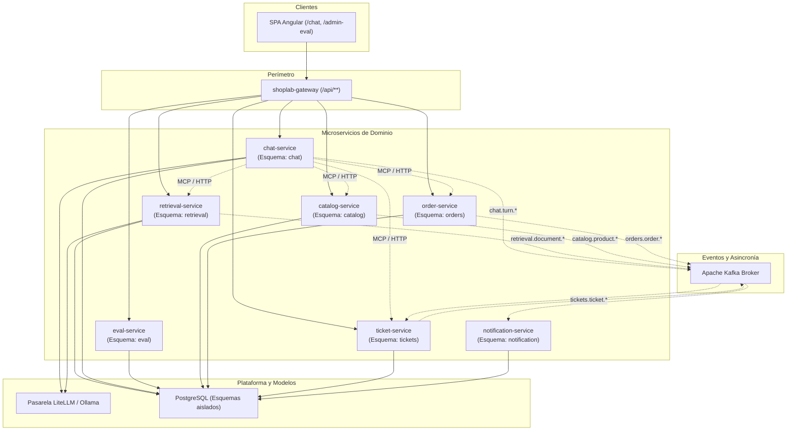

# Mapa de servicios de destino

Este documento define la topología oficial, las fronteras de datos y los protocolos de integración de los 8 servicios que componen el ecosistema distribuido de **ShopLab Helpdesk**, tras la decisión de extracción temprana acordada en [ADR-0031](adr/0031-extraccion-temprana-de-servicios.md) (LAB-128).

---

## 1. Principios de arquitectura y soberanía de datos

1. **Un repositorio por servicio**: Cada servicio cuenta con su propio repositorio en GitHub (`shoplab-<nombre>-service`), su propio ciclo de integración continua (CI) y su versionado semántico independiente gobernado por `release-please`.
2. **Soberanía estricta de datos (ADR-0015, ADR-0031)**:
   - Cada servicio es dueño exclusivo de su base de datos / esquema en PostgreSQL.
   - **Cero dependencias de base de datos compartida**: Quedan terminantemente prohibidas las claves foráneas (`FOREIGN KEY`) entre esquemas o bases de datos de diferentes servicios y las consultas `JOIN` entre contextos de negocio distintos.
   - Las referencias cruzadas se modelan exclusivamente mediante identificadores opacos (`String` / `UUID`).
3. **Cero librerías comunes con lógica de dominio (ADR-0010, ADR-0031)**:
   - Los servicios interactúan únicamente a través de contratos de red (OpenAPI y MCP) y eventos de dominio asíncronos publicados en `shoplab-contracts` (LAB-108).
   - No existe un artefacto JAR común que contenga entidades o lógica compartida. La infraestructura base no de negocio (excepciones tipadas, filtro de correlación `X-Request-Id`, logging seguro) se copia inicialmente a partir de la plantilla de servicio de **LAB-103**.
4. **Herramientas de agente vía Model Context Protocol (MCP)**:
   - Los servicios que poseen datos y operaciones de negocio (`catalog`, `order`, `ticket`, `retrieval`) levantan servidores MCP.
   - `chat-service` actúa como cliente MCP remoto sobre HTTP/SSE, manteniendo el agente desacoplado de las implementaciones de los servicios periféricos.

---

## 2. Matriz general de servicios

| Servicio | Repositorio GitHub | Esquema PostgreSQL | Tipo de servicio | Protocolos expuestos | Fase / Origen |
|---|---|---|---|---|---|
| **`chat-service`** | `shoplab-chat-service` | `chat` | Backend conversacional | REST, Streaming SSE | Extraído en S19–S24 (de `chat`) |
| **`retrieval-service`** | `shoplab-retrieval-service` | `retrieval` | Motor de búsqueda RAG | REST, Servidor MCP | Extraído en S19–S24 (de `retrieval`) |
| **`eval-service`** | `shoplab-eval-service` | `eval` | Métricas y administración | REST | Extraído en S19–S24 (de `eval`) |
| **`catalog-service`** | `shoplab-catalog-service` | `catalog` | Catálogo e inventario | REST, Servidor MCP | Nace en F3 (S25+) |
| **`order-service`** | `shoplab-order-service` | `orders` | Pedidos y tracking | REST, Servidor MCP | Nace en F4 (S30+) |
| **`ticket-service`** | `shoplab-ticket-service` | `tickets` | Soporte e incidencias | REST, Servidor MCP | Nace en F4 (S30+) |
| **`gateway`** | `shoplab-gateway` (o infra) | — *(stateless)* | API Gateway perimetral | HTTP/1.1, HTTP/2, TLS | Plataforma (F5 / F6) |
| **`notification-service`** | `shoplab-notification-service` | `notification` | Alertas transaccionales | Consumidor Kafka, REST interno | Plataforma (F5) |

---

## 3. Fichas técnicas detalladas por servicio

### 3.1. `chat-service` (Orquestador conversacional)

- **Repositorio**: `shoplab-chat-service`
- **Contexto delimitado**: Orquesta el flujo de atención al cliente en tiempo real mediante streaming, memoria contextual de turnos, evaluación de intenciones y ejecución de herramientas de agente.
- **Esquema de base de datos**: `chat`
  - `chat.conversation`: Sesiones activas y metadatos de usuario.
  - `chat.conversation_turn`: Historial inmutable de turnos de conversación, citas entregadas y trazas OTLP.
  - `chat.feedback`: Valoraciones 👍 / 👎 de respuestas, comentarios libres y estado de promoción a dataset golden (LAB-33).
- **APIs expuestas**:
  - `POST /api/chat`: Endpoint reactivo con Server-Sent Events (SSE) para streaming continuo de respuestas.
  - `PUT /api/chat/feedback/{turnId}`: Registro de feedback sobre un turno completado.
  - `GET /api/chat/feedback`: Consulta administrativa de feedbacks.
  - `GET /actuator/health`, `GET /actuator/prometheus`: Endpoints de salud y métricas.
- **Eventos Kafka**:
  - *Produce*:
    - `chat.turn.completed` (Avro / CloudEvent): Emitido al concluir un turno satisfactoriamente.
    - `chat.feedback.submitted` (Avro / CloudEvent): Emitido al registrarse una valoración.
    - `chat.turn.escalation` (Avro / CloudEvent): Emitido cuando el diálogo requiere escalado a soporte humano.
  - *Consume*: Ninguno.
- **Dependencias**:
  - Clientes MCP remotos hacia `catalog-service`, `order-service`, `ticket-service` y `retrieval-service`.
  - Pasarela de modelos LiteLLM (OpenAI-compatible) para generación de texto.
  - Base de datos PostgreSQL (esquema exclusivo `chat`).

---

### 3.2. `retrieval-service` (Recuperación y base de conocimiento)

- **Estado**: extraído (LAB-129, [ADR-0033](adr/0033-extraccion-de-retrieval-service.md)).
- **Repositorio**: `shoplab-retrieval-service`
- **Contexto delimitado**: Registro de fuentes documentales, cálculo de embeddings y búsqueda por similitud. El troceado
  lo hace `ingest`.
- **Base de datos**: propia (`retrieval`), con la extensión `pgvector`.
  - `document`: Catálogo de documentos fuente ingeridos (políticas, manuales, FAQs).
  - `chunk`: Fragmentos de texto con vectores (`vector(1024)`) e índice HNSW.
  - `indexing_lock`: Arriendo que deja indexar a una sola instancia a la vez.
- **APIs expuestas** (contrato en `shoplab-contracts`):
  - `GET /api/knowledge/search`: Búsqueda semántica.
  - `POST /api/documents`: Registro y carga de documentos en el corpus.
  - `GET /api/documents`: Listado y estado de indexación.
  - `GET /actuator/health`, `GET /actuator/prometheus`.
- **Previsto, todavía no existe**: búsqueda híbrida con BM25 y reranking (F3), servidor MCP con
  `search_knowledge_base`, y los eventos Kafka `retrieval.document.indexed` (produce) e `ingest.document.parsed`
  (consume, LAB-47).
- **Dependencias**: `ingest` por HTTP, el gateway de modelos (`embeddings`, `bge-m3`) y su PostgreSQL.

---

### 3.3. `eval-service` (Gestión histórica de evaluación RAG)

- **Repositorio**: `shoplab-eval-service`
- **Contexto delimitado**: Custodia inmutable de los resultados de corridas de evaluación de calidad de RAG (fidelidad, relevancia de respuesta, precisión de contexto) y servicios para la consola `admin-eval`.
- **Esquema de base de datos**: `eval`
  - `eval.eval_run`: Metadatos de corridas de evaluación (fecha, commit, rama, configuración, métricas globales).
  - `eval.eval_case`: Evaluaciones a nivel de pregunta/caso individual con puntajes y justificaciones.
- **APIs expuestas**:
  - `POST /api/eval/runs`: Ingesta de resultados consolidados de una corrida ejecutada en CI.
  - `GET /api/eval/runs`: Consulta histórica con evolución temporal de métricas para la UI.
  - `GET /api/eval/runs/{runId}`: Detalle desglosado de casos individuales.
  - `POST /api/eval/cases/promote`: Endpoint para certificar y registrar la promoción de un feedback a caso golden.
  - `GET /actuator/health`, `GET /actuator/prometheus`.
- **Eventos Kafka**:
  - *Produce*: `eval.run.completed`: Notifica la disponibilidad de un nuevo reporte de evaluación.
  - *Consume*: `eval.run.requested` (opcional, para corridas diferidas).
- **Dependencias**:
  - Base de datos PostgreSQL (esquema exclusivo `eval`).
  - Consumido por el frontend Angular (`/admin-eval`) y por el runner Python en CI (`shoplab-eval`).

---

### 3.4. `catalog-service` (Catálogo de productos e inventario)

- **Repositorio**: `shoplab-catalog-service`
- **Contexto delimitado**: Maestro de productos, taxonomía de categorías, atributos técnicos, precios y balance de inventario disponible en tiempo real. Nace directamente como microservicio en F3.
- **Esquema de base de datos**: `catalog`
  - `catalog.product`: Ficha de productos (título, descripción, precio, estado).
  - `catalog.category`: Jerarquía de categorías de la tienda.
  - `catalog.inventory`: Unidades disponibles en stock por almacén/vendedor.
- **APIs expuestas**:
  - `GET /api/catalog/products`: Búsqueda y filtrado de productos con paginación.
  - `GET /api/catalog/products/{id}`: Detalle técnico de un producto.
  - *Servidor MCP*: Endpoint `/mcp` con las herramientas `search_products` y `get_product_details`.
  - `GET /actuator/health`, `GET /actuator/prometheus`.
- **Eventos Kafka**:
  - *Produce*: `catalog.product.updated`, `catalog.stock.changed`.
  - *Consume*: Ninguno.
- **Dependencias**:
  - Base de datos PostgreSQL (esquema exclusivo `catalog`).

---

### 3.5. `order-service` (Gestión de órdenes y logística)

- **Repositorio**: `shoplab-order-service`
- **Contexto delimitado**: Gestión transaccional de órdenes de compra, ítems facturados, estados de despacho y tracking de envíos con transportistas. Nace directamente como microservicio en F4.
- **Esquema de base de datos**: `orders`
  - `orders.customer_order`: Cabecera de pedido, cliente, importe total y estado (`PENDING`, `PAID`, `SHIPPED`, `DELIVERED`).
  - `orders.order_item`: Líneas de producto adquiridas y precio unitario.
  - `orders.shipment`: Datos del transportista, código de rastreo y eventos logísticos.
- **APIs expuestas**:
  - `GET /api/orders/{id}`: Consulta integral de la orden de compra.
  - `GET /api/orders/{id}/tracking`: Consulta del historial de rastreo logístico.
  - *Servidor MCP*: Endpoint `/mcp` con las herramientas `get_order_status` y `track_shipment`.
  - `GET /actuator/health`, `GET /actuator/prometheus`.
- **Eventos Kafka**:
  - *Produce*: `orders.order.created`, `orders.order.shipped`, `orders.order.delivered`.
  - *Consume*: Ninguno.
- **Dependencias**:
  - Base de datos PostgreSQL (esquema exclusivo `orders`).

---

### 3.6. `ticket-service` (Atención y mesa de ayuda)

- **Repositorio**: `shoplab-ticket-service`
- **Contexto delimitado**: Gestión y seguimiento de casos de soporte e incidencias abiertas por clientes, asignación a agentes humanos y registro de resoluciones. Nace directamente como microservicio en F4.
- **Esquema de base de datos**: `tickets`
  - `tickets.support_ticket`: Encabezado de la incidencia, cliente, motivo, prioridad y estado (`OPEN`, `IN_PROGRESS`, `RESOLVED`, `CLOSED`).
  - `tickets.ticket_message`: Mensajes cruzados entre el usuario y el equipo de soporte.
- **APIs expuestas**:
  - `POST /api/tickets`: Creación de un ticket de atención al cliente.
  - `GET /api/tickets/{id}`: Consulta de estado e hilo de mensajes.
  - `POST /api/tickets/{id}/messages`: Adición de comentarios en el hilo.
  - *Servidor MCP*: Endpoint `/mcp` con las herramientas `create_ticket` y `get_ticket_status`.
  - `GET /actuator/health`, `GET /actuator/prometheus`.
- **Eventos Kafka**:
  - *Produce*: `tickets.ticket.created`, `tickets.ticket.escalated`, `tickets.ticket.resolved`.
  - *Consume*: `chat.turn.escalation`: Creación automática de ticket tras solicitud explícita en el chat.
- **Dependencias**:
  - Base de datos PostgreSQL (esquema exclusivo `tickets`).

---

### 3.7. `gateway` (API Gateway perimetral)

- **Repositorio**: `shoplab-gateway` ([ADR-0032](adr/0032-gateway-estrangulador.md), LAB-107)
- **Contexto delimitado**: Punto de entrada de la API para clientes externos (SPA Angular y aplicaciones móviles). Enruta por prefijo y propaga las cabeceras de contexto (`traceparent`, `X-Request-Id`). JWT y límite de peticiones llegan con LAB-60. La web estática (`/`) la sirve el frontend, no el gateway.
- **Esquema de base de datos**: Ninguno (*stateless*).
- **APIs expuestas / Reglas de enrutamiento** (destino al extraerse cada servicio; hasta entonces, el monolito):
  - `/api/chat/**` y `/api/assistant/**` -> `chat-service`
  - `/api/documents/**` y `/api/knowledge/**` -> `retrieval-service`
  - `/api/eval/**` -> `eval-service`
  - `/api/catalog/**` -> `catalog-service`
  - `/api/orders/**` -> `order-service`
  - `/api/tickets/**` -> `ticket-service`
- **Eventos Kafka**: Ninguno.
- **Dependencias**:
  - Servicios internos desplegados en el clúster `dev`.

---

### 3.8. `notification-service` (Notificaciones asíncronas)

- **Repositorio**: `shoplab-notification-service`
- **Contexto delimitado**: Despacho de comunicaciones y avisos transaccionales a usuarios (email, SMS, push) derivados de eventos de negocio en el ecosistema.
- **Esquema de base de datos**: `notification`
  - `notification.notification_log`: Registro de auditoría, control de idempotencia y estado de entrega de alertas.
- **APIs expuestas**:
  - `GET /api/notifications/status/{id}`: Consulta interna de entrega.
  - `GET /actuator/health`, `GET /actuator/prometheus`.
- **Eventos Kafka**:
  - *Produce*: `notification.delivery.sent`, `notification.delivery.failed`.
  - *Consume*: `orders.order.created`, `orders.order.shipped`, `tickets.ticket.created`, `tickets.ticket.resolved`.
- **Dependencias**:
  - Broker Kafka.
  - Pasarela SMTP / Proveedor de mensajería (Mailhog en entorno local).
  - Base de datos PostgreSQL (esquema exclusivo `notification`).

---

## 4. Arquitectura de herramientas de agente vía Model Context Protocol (MCP)

En cumplimiento de Jira LAB-128, la regla de encapsulamiento de `@Tool` en la `api` de ADR-0015 se traslada a la red utilizando **Model Context Protocol (MCP)** como estándar unificado:

```text
[ Usuario ] <---> [ chat-service ] (MCP Client)
                        |
                        |-- (MCP sobre HTTP/SSE) --> [ catalog-service ] (MCP Server: search_products, get_product_details)
                        |-- (MCP sobre HTTP/SSE) --> [ order-service ]   (MCP Server: get_order_status, track_shipment)
                        |-- (MCP sobre HTTP/SSE) --> [ ticket-service ]  (MCP Server: create_ticket, get_ticket_status)
                        \-- (MCP sobre HTTP/SSE) --> [ retrieval-service ](MCP Server: search_knowledge_base)
```

### 4.1. Catálogo oficial de herramientas MCP

| Servicio Dueño | Nombre de Herramienta MCP | Descripción para el Modelo | Parámetros Clave (JSON Schema) |
|---|---|---|---|
| `catalog-service` | `search_products` | Busca productos por texto libre, categoría o rango de precios. | `query` (string, req), `category` (string, opt), `max_price` (number, opt) |
| `catalog-service` | `get_product_details` | Retorna especificaciones técnicas y stock de un producto. | `product_id` (string, req) |
| `order-service` | `get_order_status` | Consulta el estado general y fecha de entrega de una orden. | `order_id` (string, req) |
| `order-service` | `track_shipment` | Proporciona el historial de eventos de rastreo de un envío. | `tracking_code` (string, req) |
| `ticket-service` | `create_ticket` | Abre una incidencia de soporte cuando se requiere ayuda humana. | `customer_id` (string, req), `subject` (string, req), `description` (string, req) |
| `ticket-service` | `get_ticket_status` | Consulta el progreso y mensajes de un ticket de soporte. | `ticket_id` (string, req) |
| `retrieval-service`| `search_knowledge_base` | Búsqueda semántica en políticas, devoluciones y FAQs. | `query` (string, req), `top_k` (integer, opt) |

### 4.2. Políticas de resiliencia y aislamiento

- **Timeout estricto**: Cada invocación MCP ejecutada por `chat-service` cuenta con un timeout máximo de **3 segundos**.
- **Degradación no bloqueante**: La indisponibilidad de un servidor MCP (por caída de pod, mantenimiento o timeout) nunca interrumpe el streaming SSE del chat ni cancela la sesión. El cliente MCP captura el fallo y comunica al LLM que el canal de datos específico se encuentra temporalmente fuera de línea, permitiendo que el modelo responda con empatía al usuario y ofrezca alternativas.
- **Cero lógica de negocio en `chat-service`**: Las reglas de validación de órdenes, cálculos de inventario o políticas de asignación de tickets residen al 100 % dentro del servicio dueño ejecutor de la herramienta.

---

## 5. Política sobre el módulo `shared`, plantilla de servicio y workflows (LAB-103)

- **Prohibición de librerías comunes de dominio**: Se prohíbe taxativamente empaquetar entidades de negocio, repositorios o servicios en librerías Maven compartidas. Compartir código de dominio introduce acoplamiento en tiempo de compilación y bloquea los despliegues independientes.
- **Plantilla de servicio (`shoplab-service-template`)**:
  - Cada microservicio se instancia a partir del repositorio plantilla oficial [`shoplab-service-template`](https://github.com/leandroamariles/shoplab-service-template) desarrollado en `LAB-103`.
  - La plantilla suministra el andamiaje técnico inicial: jerarquía base de excepciones (`BusinessException`, `TechnicalException`), filtro reactivo de correlación de peticiones (`X-Request-Id` y `traceparent`), envoltorio de respuesta estándar `ResponseDto<T>` y `ErrorDto`, logging estructurado seguro, migrador Flyway mono-esquema, pruebas de arquitectura ArchUnit y configuración de Resource Server JWT para Keycloak (LAB-61).
  - Cada microservicio gestiona su propio catálogo de códigos de error tipados (`CHAT_...`, `CATL_...`, `ORDR_...`, `TCKT_...`), evolucionando de manera totalmente autónoma.
  - Dependencia fijada exclusivamente a `com.shoplab:shoplab-contracts` (LAB-108) sin dependencias de código hacia el monolito ni hacia repositorios hermanos.
- **Workflows reutilizables (`shoplab-ci`)**:
  - Todo microservicio delega su pipeline en `shoplab-ci/.github/workflows/java-service.yml@v1` (o `python-service.yml@v1` / `angular-app.yml@v1`), aplicando gates de compilación, Testcontainers, JaCoCo ≥80 %, Qodana, Trivy (HIGH/CRITICAL) y políticas anti `:latest` y `CAMBIA-ESTE-OWNER`.
  - Generación de atestaciones SBOM, firma criptográfica keyless con Cosign en GHCR y job de despliegue GitOps automático hacia `shoplab-infra`.
- **Guía de creación paso a paso**:
  - El procedimiento detallado de instanciación, parametrización y registro de nuevos servicios se encuentra documentado en [docs/fases/F5-creacion-de-servicios-desde-plantilla.md](fases/F5-creacion-de-servicios-desde-plantilla.md).
- **Gobernanza de contratos**: Toda interfaz entre servicios se rige por especificaciones OpenAPI 3.1 y esquemas Avro versionados centralmente en el repositorio `shoplab-contracts` (LAB-108).

---

## 6. Delimitación de responsabilidades de evaluación

| Aspecto | `shoplab-eval-service` (Java) | `shoplab-eval` (Python) |
|---|---|---|
| **Tecnología** | Java 21 + Spring Boot 4 + WebFlux | Python ≥ 3.12 + `uv` |
| **Repositorio** | `shoplab-eval-service` | `shoplab-eval` |
| **Rol principal** | Persistencia histórica y APIs de backend | Suite de evaluación RAGAS/DeepEval y CLI |
| **Almacenamiento** | Esquema PostgreSQL `eval` (`eval_run`, `eval_case`) | Dataset golden en archivos (`eval/golden.jsonl`) |
| **Interacción UI** | Fuente de datos para la pantalla Angular `admin-eval` | No interactúa directamente con la UI |
| **Interacción CI** | Expone `POST /api/eval/runs` para registrar resultados | Ejecuta la evaluación contra el sistema y reporta a `eval-service` |

---

## 7. Diagrama de topología general


