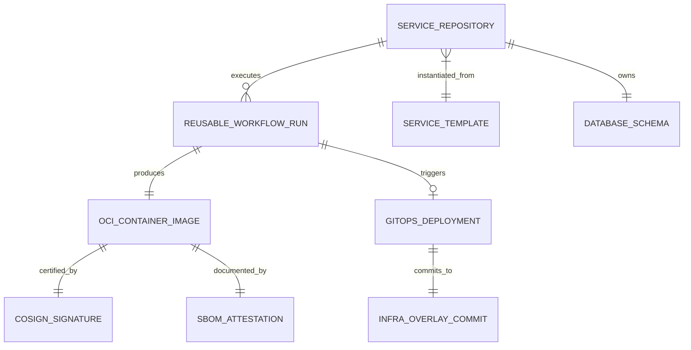
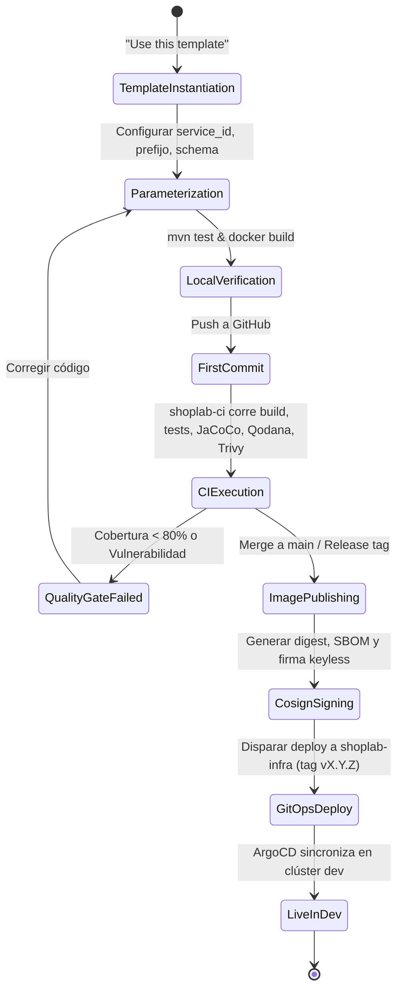

# Data Model & Specification Entities: Workflows reutilizables y plantilla de servicio

**Feature**: `LAB-103-reusable-workflows-service-template`
**Date**: 2026-11-24
**Status**: Completed

---

## 1. Visión General de Entidades

Aunque esta historia de usuario aborda principalmente componentes de infraestructura como código (IaC), pipelines de CI/CD y arquetipos de repositorio, existen entidades clave y contratos de datos bien definidos que gobiernan la ejecución de los workflows, la publicación de contenedores y la instanciación de servicios.



---

## 2. Entidades de Plataforma y CI/CD

### 2.1. `ReusableWorkflowRun` (Ejecución de Workflow Reutilizable)
Representa una invocación de uno de los flujos de `shoplab-ci` (`java-service`, `python-service`, `angular-app`) por parte de un microservicio consumidor.

| Atributo | Tipo | Descripción | Restricciones / Reglas |
|---|---|---|---|
| `caller_repo` | `String` | Repositorio que invoca el workflow | Formato: `leandroamariles/shoplab-<servicio>` |
| `ref` | `String` | Git ref que disparó el flujo | Rama (`refs/heads/...`) o Tag (`refs/tags/v*.*.*`) |
| `workflow_type` | `Enum` | Tipo de stack tecnológico | Valores: `java-service`, `python-service`, `angular-app` |
| `java_version` | `Integer` | Versión del JDK (para Java) | Por defecto: `21` |
| `coverage_threshold` | `Integer` | Porcentaje mínimo de cobertura | Por defecto: `80` (falla si < 80) |
| `trivy_severity` | `String` | Severidades que bloquean el build | Por defecto: `HIGH,CRITICAL` |
| `qodana_enabled` | `Boolean` | Flag para análisis Qodana | Por defecto: `true` |
| `testcontainers_enabled` | `Boolean` | Flag para tests con contenedores | Por defecto: `true` |

### 2.2. `OciContainerImage` (Imagen de Contenedor OCI)
Artefacto ejecutable empaquetado y publicado en el registro de GitHub Container Registry (GHCR).

| Atributo | Tipo | Descripción | Formato / Ejemplo |
|---|---|---|---|
| `registry` | `String` | Registro OCI destino | `ghcr.io` |
| `namespace` | `String` | Organización / Usuario propietario | `leandroamariles` |
| `service_name` | `String` | Nombre unívoco del microservicio | `chat-service`, `retrieval-service`, etc. |
| `commit_sha` | `String` | SHA-1 completo del commit origen | 40 caracteres hexadecimales |
| `tags` | `List<String>` | Etiquetas asociadas al contenedor | `:sha-<commit>` (siempre) y `:vX.Y.Z` (en releases) |
| `digest` | `String` | Digest inmutable del contenido de la imagen | `sha256:<64 hex chars>` |
| `provenance_mode` | `String` | Nivel de atestación de procedencia | `max` (SLSA Provenance) |
| `sbom_format` | `String` | Formato del Software Bill of Materials | `spdx-json` / `cyclonedx-json` |

### 2.3. `CosignSignature` (Firma Criptográfica Keyless)
Metadatos criptográficos generados por Cosign para atestar la autenticidad e inmutabilidad de la imagen.

| Atributo | Tipo | Descripción | Regla de Verificación |
|---|---|---|---|
| `target_digest` | `String` | Digest de la imagen firmado | `sha256:...` (nunca se firma por tag) |
| `oidc_issuer` | `String` | Emisor del certificado OIDC efímero | `https://token.actions.githubusercontent.com` |
| `cert_identity` | `String` | Identidad del flujo de GitHub Actions | Coincide con `^https://github.com/leandroamariles/.*` |
| `transparency_log` | `String` | Entrada en el log público de Rekor | Verificado automáticamente vía Rekor |

### 2.4. `GitOpsDeployment` (Despliegue GitOps en `shoplab-infra`)
Operación de actualización del estado deseado en el clúster de Kubernetes vía Kustomize.

| Atributo | Tipo | Descripción | Restricciones / Reglas |
|---|---|---|---|
| `target_repo` | `String` | Repositorio de infraestructura | `shoplab-infra` |
| `target_overlay` | `String` | Carpeta de overlay del entorno | `k8s/overlays/dev` |
| `service_name` | `String` | Nombre del servicio a actualizar | Debe existir en `images:` de `kustomization.yaml` |
| `new_image_tag` | `String` | Versión a fijar | Formato estricto: `vX.Y.Z` (prohibido `:latest`) |
| `auth_token_scope` | `String` | Permisos del token de GitHub App | Exclusivo `shoplab-infra:contents:write` |
| `commit_author` | `String` | Identidad del autor del commit | `shoplab-deploy[bot]` |

---

## 3. Entidades de la Plantilla de Servicio (`shoplab-service-template`)

### 3.1. `ServiceMetadata` (Metadatos del Microservicio)
Propiedades de configuración inicial que personalizan un servicio al nacer de la plantilla.

| Atributo | Tipo | Descripción | Ejemplo / Placeholder |
|---|---|---|---|
| `service_id` | `String` | Identificador kebab-case del servicio | `chat-service`, `catalog-service` |
| `service_prefix` | `String` | Prefijo mayúsculas para códigos de error | `CHAT`, `CATL`, `RETR`, `ORDR`, `TCKT` |
| `package_name` | `String` | Paquete raíz Java del servicio | `com.shoplab.<servicio>` |
| `db_schema` | `String` | Nombre del esquema PostgreSQL propio | `<servicio>` (ej. `chat`, `catalog`) |
| `http_port` | `Integer` | Puerto HTTP asignado | Por defecto: `8080` (remapeado en Compose/K8s) |
| `contracts_version` | `String` | Versión fijada de `shoplab-contracts` | `1.0.0` (fijado sin comodines) |

### 3.2. `ResponseDto<T>` y `ErrorDto` (Estructura Estándar de Respuesta)
Contrato JSON uniforme para todas las respuestas de la API en el microservicio.

```json
{
  "data": { ... },
  "errors": [
    {
      "code": "CHAT_GE_00001",
      "description": "Invalid request parameter",
      "attributes": {
        "field": "message",
        "reason": "must not be blank"
      }
    }
  ]
}
```

* **`ResponseDto<T>`**:
  - `data` (`T`): Carga útil exitosa; `null` si hay error.
  - `errors` (`List<ErrorDto>`): Lista de errores; vacía en caso de éxito.
* **`ErrorDto`**:
  - `code` (`String`): Código alfanumérico tipado con prefijo (`<PREFIX>_<SUBSYSTEM>_<NUMBER>`).
  - `description` (`String`): Mensaje legible en inglés para soporte y logs.
  - `attributes` (`Map<String, String>`): Metadatos adicionales de depuración o validación.

### 3.3. `DatabaseSchemaConfig` (Configuración de Persistencia Aislada)
Modelo de persistencia mono-esquema con Flyway.

| Propiedad Spring | Valor Configurado | Justificación |
|---|---|---|
| `spring.flyway.enabled` | `true` | Automatización de migraciones en arranque |
| `spring.flyway.schemas` | `${SERVICE_NAME}` | Soberanía estricta de esquema |
| `spring.flyway.default-schema` | `${SERVICE_NAME}` | Garantiza que las tablas se creen en su esquema |
| `spring.flyway.locations` | `classpath:db/migration/${SERVICE_NAME}` | Directorio de scripts SQL aislado |
| `spring.flyway.table` | `flyway_schema_history` | Tabla de historial dentro del esquema del servicio |

---

## 4. Máquina de Estados del Ciclo de Vida de un Servicio


