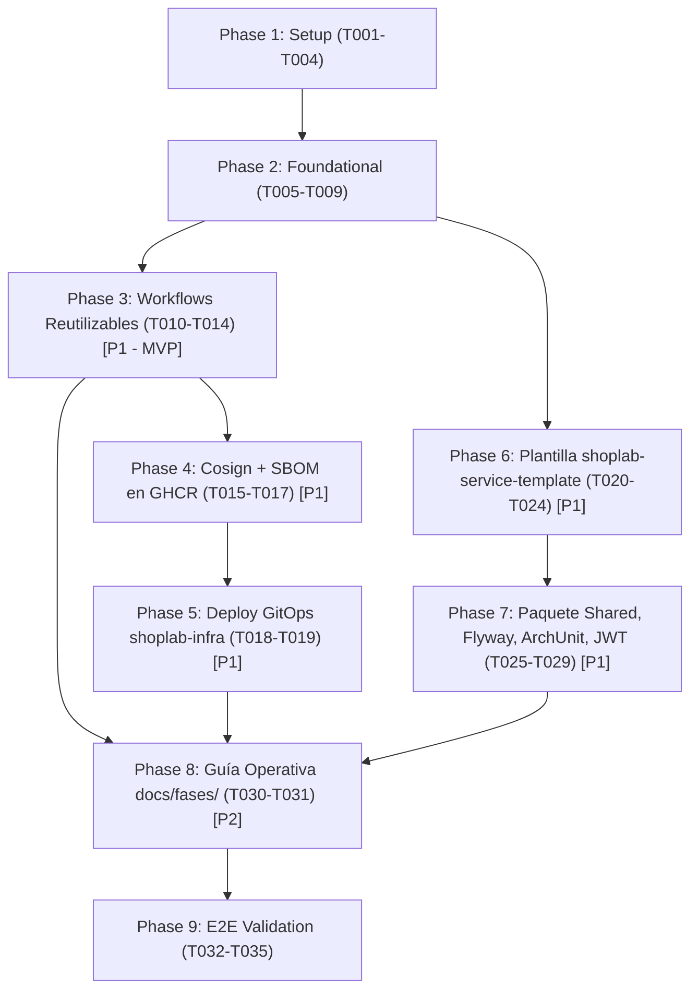

# Tasks: Workflows reutilizables y plantilla de servicio (shoplab-ci y shoplab-service-template)

**Input**: Design documents from `/specs/LAB-103-reusable-workflows-service-template/`  
**Prerequisites**: [plan.md](file:///C:/Users/Leandro/IdeaProjects/shoplab-helpdesk/specs/LAB-103-reusable-workflows-service-template/plan.md), [spec.md](file:///C:/Users/Leandro/IdeaProjects/shoplab-helpdesk/specs/LAB-103-reusable-workflows-service-template/spec.md), [research.md](file:///C:/Users/Leandro/IdeaProjects/shoplab-helpdesk/specs/LAB-103-reusable-workflows-service-template/research.md), [data-model.md](file:///C:/Users/Leandro/IdeaProjects/shoplab-helpdesk/specs/LAB-103-reusable-workflows-service-template/data-model.md), [contracts/](file:///C:/Users/Leandro/IdeaProjects/shoplab-helpdesk/specs/LAB-103-reusable-workflows-service-template/contracts/), [quickstart.md](file:///C:/Users/Leandro/IdeaProjects/shoplab-helpdesk/specs/LAB-103-reusable-workflows-service-template/quickstart.md)

---

## Format: `[ID] [P?] [Story] Description`

- **[P]**: Ejecutable en paralelo (archivos independientes, sin colisiones de estado ni dependencias mutuas)
- **[Story]**: Historia de usuario correspondiente (`US1`, `US2`, `US3`, `US4`, `US5`, `US6`)
- Rutas explícitas para cada repositorio (`shoplab-ci/`, `shoplab-service-template/` o `shoplab-helpdesk/`)

---

## Phase 1: Setup (Shared Infrastructure)

**Purpose**: Inicialización del espacio de trabajo y estructura base de los dos nuevos repositorios de plataforma: `shoplab-ci` y `shoplab-service-template`.

- [x] T001 Inicializar el directorio y repositorio Git `shoplab-ci` con ramas principales y configuración `.gitignore` en `shoplab-ci/.gitignore`
- [x] T002 [P] Crear archivo `README.md` y documentación de catálogo de workflows en `shoplab-ci/README.md`
- [x] T003 [P] Inicializar el directorio y repositorio Git `shoplab-service-template` con configuración `.gitignore` en `shoplab-service-template/.gitignore`
- [x] T004 [P] Configurar el linter y reglas de formato para YAML, Markdown y JSON en `shoplab-ci/.editorconfig` y `shoplab-service-template/.editorconfig`

---

## Phase 2: Foundational (Blocking Prerequisites)

**Purpose**: Automatizaciones base de CI, versionado y gobernanza comunes a ambos repositorios.

**⚠️ CRITICAL**: Ninguna historia de usuario puede publicarse de forma gobernable sin esta base.

- [x] T005 Configurar la validación de títulos Conventional Commits en `shoplab-ci/.github/workflows/pr-title.yml` y `shoplab-service-template/.github/workflows/pr-title.yml`
- [x] T006 [P] Configurar `release-please` para el repositorio `shoplab-ci` en `shoplab-ci/release-please-config.json` y `.release-please-manifest.json` para gestionar el versionado de workflows y tags flotantes `@v1`
- [x] T007 [P] Configurar workflow de release automático en `shoplab-ci/.github/workflows/release-please.yml`
- [x] T008 [P] Configurar actualización automática de dependencias en `shoplab-ci/.github/dependabot.yml` para GitHub Actions
- [x] T009 [P] Configurar Dependabot en `shoplab-service-template/.github/dependabot.yml` para Maven, GitHub Actions y el registro de GitHub Packages

**Checkpoint**: Base de gobernanza lista: repositorios inicializados, versionado semántico y dependencias automáticas operativas.

---

## Phase 3: User Story 1 - Workflows reutilizables en `shoplab-ci` con puertas de calidad integradas (Priority: P1) 🎯 MVP

**Goal**: Proveer en `shoplab-ci` los workflows reutilizables `java-service.yml`, `python-service.yml` y `angular-app.yml` invocables vía `workflow_call` con validación estricta de compilación, tests, JaCoCo ≥80 %, Qodana, Trivy y políticas de seguridad.

**Independent Test**: Invocar desde un repositorio de prueba cada workflow y comprobar que: (1) un proyecto correcto pasa en verde; (2) un proyecto con cobertura <80 %, hallazgos Trivy HIGH/CRITICAL, tag `:latest` o el texto `CAMBIA-ESTE-OWNER` falla el check y bloquea el PR.

### Implementation for User Story 1

- [x] T010 [US1] Implementar el script de validación de políticas en `shoplab-ci/scripts/check-policies.sh` que verifique la ausencia de `:latest` en manifiestos YAML y del marcador prohibido `CAMBIA-ESTE-OWNER`
- [x] T011 [US1] Implementar el workflow reutilizable `shoplab-ci/.github/workflows/java-service.yml` (conforme a [reusable-workflows-contract.md](file:///C:/Users/Leandro/IdeaProjects/shoplab-helpdesk/specs/LAB-103-reusable-workflows-service-template/contracts/reusable-workflows-contract.md)):
  - Input parameters: `java-version` (default 21), `coverage-threshold` (default 80), `qodana-enabled`, `trivy-scan`, `image-name`
  - Ejecución de `check-policies.sh`
  - Setup JDK con caché Maven
  - `mvn clean verify -B` ejecutando Testcontainers
  - Extracción y evaluación de cobertura JaCoCo desde `target/site/jacoco/jacoco.csv` (falla si < 80 %)
  - Análisis estático con `JetBrains/qodana-action` (falla con findings)
  - Escaneo de sistema de archivos con `aquasecurity/trivy-action` (`scan-type: fs`, severidad HIGH,CRITICAL, exit-code 1)
- [x] T012 [P] [US1] Implementar el workflow reutilizable `shoplab-ci/.github/workflows/python-service.yml`:
  - Instalación de Python 3.11+ y gestor `uv`
  - Ejecución de linters y formateadores (Ruff)
  - Ejecución de tests con `pytest` y validación de cobertura mínima
  - Escaneo de vulnerabilidades en dependencias y filesystem con Trivy
  - Chequeo de políticas de seguridad
- [x] T013 [P] [US1] Implementar el workflow reutilizable `shoplab-ci/.github/workflows/angular-app.yml`:
  - Setup Node.js 22 y caché npm
  - `npm ci`
  - Linter de frontend (`npm run lint`)
  - Tests unitarios headless (`npm run test -- --no-watch --browsers=ChromeHeadless`)
  - Compilación de producción (`npm run build`)
  - Escaneo de dependencias npm con Trivy
- [x] T014 [US1] Crear suite de pruebas de CI y fixtures de prueba en `shoplab-ci/tests/` para verificar el comportamiento de los tres workflows ante condiciones de éxito y fallo

**Checkpoint**: User Story 1 completada y verificada independientemente.

---

## Phase 4: User Story 2 - Construcción, escaneo, SBOM y firma criptográfica de imágenes OCI con Cosign (Priority: P1)

**Goal**: Empaquetar y publicar contenedores en `ghcr.io/leandroamariles/<servicio>` con tags inmutables (`:sha-<commit>` y `:vX.Y.Z`), generando atestación de procedencia (SLSA max), SBOM y firma criptográfica keyless con Cosign.

**Independent Test**: Ejecutar el flujo de publicación ante un tag de release `vX.Y.Z`, verificar que la imagen queda publicada en GHCR, rechaza sobrescribir si el tag ya existía, incluye SBOM adjunto y pasa la verificación `cosign verify` con el emisor OIDC de GitHub Actions.

### Implementation for User Story 2

- [x] T015 [US2] Implementar el job reutilizable de publicación y firma en `shoplab-ci/.github/workflows/publish-image.yml`:
  - Autenticación en `ghcr.io` con token de GitHub Packages
  - Step de seguridad: comprobar con `docker buildx imagetools inspect` que el tag `vX.Y.Z` no existe previamente en GHCR (inmutabilidad estricta)
  - Construcción de imagen con `docker/build-push-action`:
    - Tags: `:sha-<commit>` y `:vX.Y.Z` (o `:latest` condicionado a `main`)
    - `sbom: true` (generación automática de SBOM SPDX/CycloneDX)
    - `provenance: mode=max` (SLSA provenance)
    - Push al registro GHCR
- [x] T016 [US2] Integrar la firma criptográfica keyless con Cosign en `shoplab-ci/.github/workflows/publish-image.yml`:
  - Instalación de `sigstore/cosign-installer`
  - Firma del digest inmutable (`cosign sign --yes "${IMAGE}@${DIGEST}"`) con permisos `id-token: write`
  - Verificación inmediata de la firma (`cosign verify` validando identidad OIDC del repo llamador y emisor de GitHub)
  - Generación de resumen de publicación en `$GITHUB_STEP_SUMMARY`
- [x] T017 [US2] Conectar `publish-image.yml` como etapa posterior en `java-service.yml`, `python-service.yml` y `angular-app.yml` condicionada a eventos de push en `main` o tags de versión

**Checkpoint**: User Story 2 completada: publicación segura de contenedores con firma criptográfica y trazabilidad de artefactos.

---

## Phase 5: User Story 3 - Job de despliegue reutilizable GitOps sobre `shoplab-infra` (Priority: P1)

**Goal**: Automatizar la actualización de imágenes en el clúster `dev` de `shoplab-infra` mediante `kustomize edit set image` utilizando un token de GitHub App de alcance mínimo.

**Independent Test**: Invocar el job de despliegue con un servicio y versión válidos; comprobar que genera un commit en `shoplab-infra` actualizando `kustomization.yaml`, rechazando tags `:latest`, validando con `policy-check.sh` y manejando reintentos ante colisiones de concurrencia.

### Implementation for User Story 3

- [x] T018 [US3] Crear el script de despliegue reutilizable `shoplab-ci/scripts/deploy-infra.sh` (conforme a [deploy-job-contract.md](file:///C:/Users/Leandro/IdeaProjects/shoplab-helpdesk/specs/LAB-103-reusable-workflows-service-template/contracts/deploy-job-contract.md)):
  - Valida inputs (`SERVICE_NAME`, `IMAGE_TAG`, `INFRA_DIR`, etc.)
  - Comprueba que la imagen existe físicamente en GHCR antes de editar
  - Ejecuta `kustomize edit set image` sobre `k8s/overlays/dev`
  - Compila con `kustomize build` y valida ausencia de `:latest`
  - Ejecuta `policy-check.sh` de `shoplab-infra`
  - Realiza commit y push con reintentos (`git pull --rebase` hasta 3 veces) con autor `shoplab-deploy[bot]`
- [x] T019 [US3] Implementar el workflow reutilizable `shoplab-ci/.github/workflows/deploy.yml`:
  - Inputs: `service-name`, `image-tag`, `image-namespace`, `overlay`, `branch`
  - Generación de token efímero de GitHub App con `actions/create-github-app-token` acotado exclusivamente a `shoplab-infra:contents:write`
  - Checkout sparse de `shoplab-infra`
  - Instalación de Kustomize
  - Ejecución de `deploy-infra.sh`
  - Enmascaramiento estricto del token en logs

**Checkpoint**: User Story 3 completada: entrega continua GitOps desacoplada y segura.

---

## Phase 6: User Story 4 - Repositorio plantilla `shoplab-service-template` configurado y desacoplado (Priority: P1)

**Goal**: Configurar el repositorio `shoplab-service-template` como GitHub Template Repository con el POM parent Spring Boot 4.x, Dockerfile multi-stage, dependabot, release-please y dependencia fijada a `shoplab-contracts`.

**Independent Test**: Instanciar un repositorio desde la plantilla, ejecutar `mvn clean verify` y `docker build`, y verificar que el workflow invoca a `shoplab-ci` sin dependencias del monolito.

### Implementation for User Story 4

- [x] T020 [US4] Configurar el archivo raíz `shoplab-service-template/pom.xml` (conforme a [service-template-contract.md](file:///C:/Users/Leandro/IdeaProjects/shoplab-helpdesk/specs/LAB-103-reusable-workflows-service-template/contracts/service-template-contract.md)):
  - Parent `spring-boot-starter-parent` (Spring Boot 4.x / Java 21)
  - Dependencias: WebFlux, Actuator, OAuth2 Resource Server, Flyway PostgreSQL, Testcontainers, ArchUnit
  - Dependencia declarada y fijada a `com.shoplab:shoplab-contracts` (versión fija, sin comodines)
  - Cero dependencias hacia `shoplab-helpdesk` o código de otros servicios
  - Plugin JaCoCo con reporte CSV y exclusiones estándar
- [x] T021 [US4] Crear el archivo `shoplab-service-template/Dockerfile` multi-stage:
  - Stage 1: Build y empaquetado con JDK 21
  - Stage 2: Imagen final optimizada y segura (Eclipse Temurin JRE / Distroless)
  - Usuario sin privilegios (`nonroot`), sin herramientas innecesarias
- [x] T022 [P] [US4] Configurar `shoplab-service-template/.github/release-please-config.json` y `.release-please-manifest.json` con versión inicial `0.1.0` y workflow `.github/workflows/release-please.yml`
- [x] T023 [P] [US4] Configurar los workflows en la plantilla:
  - `shoplab-service-template/.github/workflows/ci.yml` invocando `leandroamariles/shoplab-ci/.github/workflows/java-service.yml@v1`
  - `shoplab-service-template/.github/workflows/deploy.yml` invocando `shoplab-ci/.github/workflows/deploy.yml@v1` tras publicar una release
- [x] T024 [US4] Crear la clase principal de arranque en `shoplab-service-template/src/main/java/com/shoplab/template/TemplateServiceApplication.java`

**Checkpoint**: User Story 4 completada: estructura de plantilla lista para instanciar repositorios autónomos.

---

## Phase 7: User Story 5 - Paquete transversal base (`shared`), Flyway mono-esquema, ArchUnit y JWT Resource Server (Priority: P1)

**Goal**: Proveer en la plantilla la infraestructura transversal de código limpio: manejo uniforme de errores, correlación reactiva, persistencia aislada en un esquema, reglas de arquitectura hexagonal y seguridad JWT.

**Independent Test**: Ejecutar los tests de la plantilla y validar que: (1) ArchUnit bloquea violaciones de capas o importaciones del monolito; (2) `GlobalExceptionHandler` devuelve el envelope `ResponseDto` con error tipado; (3) Flyway corre sobre el esquema exclusivo del servicio; (4) el Resource Server JWT rechaza accesos sin token válido.

### Implementation for User Story 5

- [x] T025 [P] [US5] Implementar el paquete de excepciones y respuestas en `shoplab-service-template/src/main/java/com/shoplab/template/shared/`:
  - `exception/BusinessException.java` y `exception/TechnicalException.java`
  - `exception/ResponseCodeEnum.java` con códigos estándar (`_GE_00001`, `_AUTH_00001`, `_DB_00001`) y prefijo parametrizable
  - `model/ResponseDto.java` y `model/ErrorDto.java`
  - `exception/GlobalExceptionHandler.java` (RestControllerAdvice con mapeo de errores tipados y fallback a `UNKNOWN_ERROR`)
  - Pruebas unitarias en `src/test/java/com/shoplab/template/shared/GlobalExceptionHandlerTest.java`
- [x] T026 [P] [US5] Implementar el filtro de correlación y logging seguro:
  - `filter/CorrelationFilter.java` (WebFilter reactivo que inyecta y propaga `X-Request-Id` y `traceparent` en Reactor Context, MDC y response headers)
  - `logging/SecureLogger.java` con enmascaramiento de datos sensibles
  - `src/main/resources/logback-spring.xml` (consola local y encoder JSON de Logstash para producción)
- [x] T027 [US5] Configurar Flyway mono-esquema y persistencia:
  - Configuración en `src/main/resources/application.yml` con `spring.flyway.schemas=${SERVICE_NAME:template}` y `spring.flyway.locations=classpath:db/migration/${SERVICE_NAME:template}`
  - Migración semilla `src/main/resources/db/migration/template/V1__initial_schema.sql`
  - Prueba de integración `src/test/java/com/shoplab/template/persistence/FlywayMigrationIntegrationTest.java` con Testcontainers PostgreSQL 16
- [x] T028 [US5] Implementar las reglas de arquitectura hexagonal con ArchUnit en `src/test/java/com/shoplab/template/architecture/HexagonalArchitectureTest.java`:
  - Regla: `domain` no depende de `application`, `infrastructure`, Spring, JPA ni Reactor
  - Regla: prohibido importar clases del monolito (`com.shoplab.helpdesk..`)
  - Regla: controladores en `infrastructure/in/rest` no contienen lógica ni construyen `ResponseEntity` de error directo
- [x] T029 [US5] Implementar la configuración de seguridad reactiva en `src/main/java/com/shoplab/template/infrastructure/in/rest/config/SecurityConfig.java` con `spring-boot-starter-oauth2-resource-server` para validación de tokens JWT (LAB-61)

**Checkpoint**: User Story 5 completada: plantilla técnica completamente dotada de patrones transversales robustos.

---

## Phase 8: User Story 6 - Guía operativa de extracción y creación de servicios en `docs/fases/` (Priority: P2)

**Goal**: Documentar el proceso paso a paso para que cualquier desarrollador pueda instanciar un servicio desde la plantilla o extraer uno existente en menos de 15 minutos.

**Independent Test**: Seguir la guía en un walkthrough técnico y constatar que se cubren todos los pasos de renombrado, configuración de secretos, esquemas de base de datos y registro en `shoplab-infra`.

### Implementation for User Story 6

- [x] T030 [US6] Redactar la guía operativa `docs/fases/F5-creacion-de-servicios-desde-plantilla.md`:
  - Instrucciones de clonación desde GitHub Template
  - Checklist de parametrización (renombrado de paquetes, prefijo de errores, esquema Flyway)
  - Configuración de secretos de GitHub (`DEPLOY_APP_ID`, `DEPLOY_APP_PRIVATE_KEY`, permisos GHCR)
  - Pasos para dar de alta el servicio en `shoplab-infra/k8s/overlays/dev/kustomization.yaml`
  - Matriz de solución de problemas frecuentes (Testcontainers, errores de ArchUnit, firmas Cosign)
- [x] T031 [US6] Actualizar `docs/mapa-servicios.md` vinculando `shoplab-service-template` y `shoplab-ci` como los estándares oficiales de plataforma para la extracción temprana de servicios

**Checkpoint**: User Story 6 completada: documentación oficial y guías de onboarding publicadas.

---

## Phase 9: Verification & E2E Validation

**Purpose**: Verificación global de integración entre repositorios y validación de los criterios de aceptación.

- [x] T032 [P] Ejecutar verificación en seco de la plantilla: `mvn clean verify` en `shoplab-service-template/` comprobando que supera el 85 % de cobertura JaCoCo y que todos los tests de arquitectura pasan
- [x] T033 [P] Validar el build del contenedor de la plantilla con `docker build` asegurando que no genera warnings de seguridad
- [x] T034 Simular la invocación de `shoplab-ci/java-service.yml` desde un pipeline de prueba comprobando el bloqueo ante cobertura < 80 % y el pase en verde ante cumplimiento
- [x] T035 Validar el flujo de despliegue en seco con `deploy-infra.sh` sobre un fork o rama de pruebas de `shoplab-infra` verificando que no expone tokens y actualiza `kustomization.yaml` correctamente

---

## Dependency Graph & Milestones

