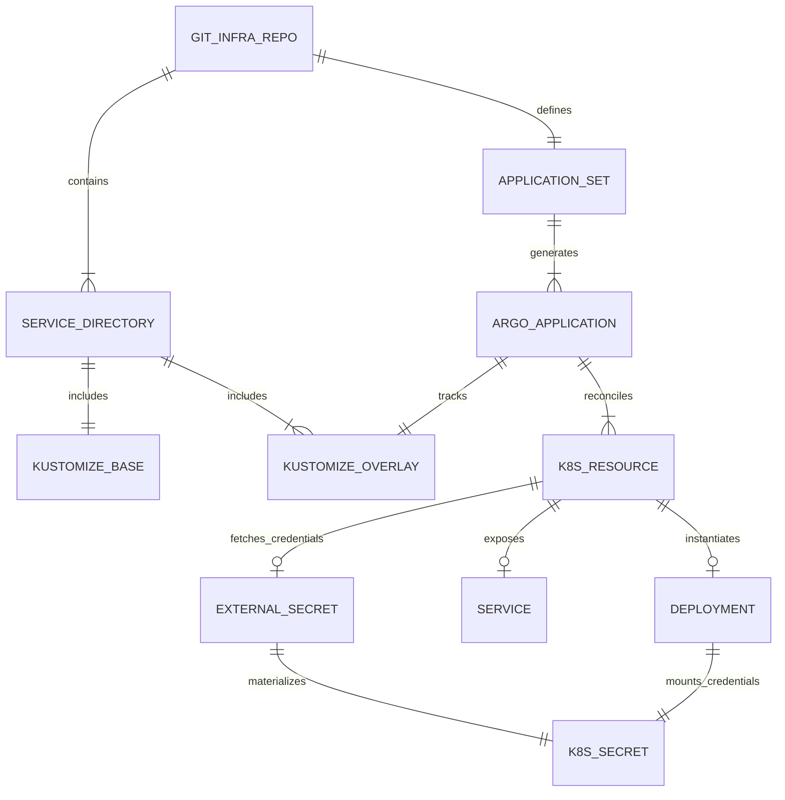

# Data Model & Declarative Entities: Despliegue por servicio en dev con ApplicationSet

**Feature**: `LAB-104-dev-deployment-applicationset`
**Date**: 2026-11-25
**Status**: Completed

---

## 1. Diagrama de Relación de Entidades GitOps



---

## 2. Definición de Entidades Declarativas

### 2.1. `ApplicationSet` (Generador de Aplicaciones Argo CD)
Recurso CRD (`argoproj.io/v1alpha1`) que automatiza el descubrimiento de microservicios y la creación de sus respectivas `Application`.

| Atributo | Tipo | Descripción | Regla / Valor |
|---|---|---|---|
| `metadata.name` | `String` | Nombre del generador | `shoplab-services-dev` |
| `metadata.namespace` | `String` | Namespace de Argo CD | `argocd` |
| `spec.generators[].git.repoURL` | `String` | URL del repositorio de infraestructura | `https://github.com/leandroAmariles/shoplab-infra.git` |
| `spec.generators[].git.revision` | `String` | Rama monitoreada | `main` |
| `spec.generators[].git.directories[].path` | `String` | Patrón de búsqueda de servicios | `apps/*/overlays/dev` |
| `template.metadata.name` | `String` | Nombre de la Application resultante | `{{path[1]}}-dev` (ej. `chat-service-dev`) |
| `template.spec.source.path` | `String` | Ruta en Git a desplegar | `{{path}}` |
| `template.spec.destination.namespace` | `String` | Namespace destino en el clúster | `shoplab-dev` |
| `template.spec.destination.server` | `String` | Servidor del clúster | `https://kubernetes.default.svc` |
| `template.spec.syncPolicy.automated.prune` | `Boolean` | Poda automática de recursos eliminados | `true` |
| `template.spec.syncPolicy.automated.selfHeal` | `Boolean` | Autoreparación ante drift manual | `true` |

---

### 2.2. `ServiceDirectory` (Estructura de Directorio por Microservicio)
Convención inmutable de carpetas en `shoplab-infra` para alojar los manifiestos de un microservicio.

| Componente de Ruta | Función | Archivos Obligatorios |
|---|---|---|
| `apps/<servicio>/` | Directorio raíz del servicio | Carpeta contenedora nombrada según el catálogo oficial |
| `apps/<servicio>/base/` | Definición neutra y agnóstica de entorno | `kustomization.yaml`, `deployment.yaml`, `service.yaml`, `externalsecret.yaml` |
| `apps/<servicio>/overlays/dev/` | Especialización para el entorno `dev` | `kustomization.yaml` (fijando réplicas = 1 y la imagen con tag inmutable) |

---

### 2.3. `ExternalSecret` (Contrato de Credenciales de Base de Datos)
Recurso CRD (`external-secrets.io/v1beta1`) que desacopla la obtención de secretos del código en Git.

| Atributo | Tipo | Descripción | Regla / Valor |
|---|---|---|---|
| `metadata.name` | `String` | Nombre del recurso | `<servicio>-db-credentials` |
| `metadata.namespace` | `String` | Namespace de Kubernetes | `shoplab-dev` |
| `spec.secretStoreRef.name` | `String` | Almacén de secretos configurado | `cluster-secret-store` (o `vault-store`) |
| `spec.target.name` | `String` | Nombre del `Secret` nativo a generar | `<servicio>-db-secret` |
| `spec.data[].secretKey` | `String` | Clave expuesta al contenedor | `SPRING_DATASOURCE_USERNAME`, `SPRING_DATASOURCE_PASSWORD`, `SPRING_DATASOURCE_URL` |
| `spec.data[].remoteRef.key` | `String` | Ruta en el gestor de secretos | `shoplab/dev/<servicio>/database` |

---

### 2.4. `DeployJobExecution` (Ejecución del Job de Despliegue con Rebase)
Modelo de datos del proceso de entrega continua ejecutado por el runner de GitHub Actions.

| Atributo | Tipo | Descripción | Regla / Validación |
|---|---|---|---|
| `service_name` | `String` | Nombre del servicio emisor | Debe existir en `apps/` de `shoplab-infra` |
| `image_tag` | `String` | Tag inmutable de la versión | Formato estricto `vX.Y.Z` (prohibido `:latest`) |
| `target_file` | `String` | Archivo modificado por Kustomize | `apps/<servicio>/overlays/dev/kustomization.yaml` |
| `max_retries` | `Integer` | Intentos máximos de push con rebase | `3` |
| `backoff_base_sec` | `Integer` | Base de espera entre reintentos | `2` segundos (+ jitter aleatorio hasta 5s) |
| `commit_message` | `String` | Mensaje de commit convencional | `chore(dev): [LAB-104] despliega <servicio> <tag> a dev` |
| `commit_author` | `String` | Identidad del autor del commit | `shoplab-deploy[bot]` |

---

## 3. Matriz de Variables de Entorno Inyectadas por Servicio

Cada `Deployment` en `apps/<servicio>/base/deployment.yaml` consume las siguientes variables:

```yaml
env:
  - name: SPRING_PROFILES_ACTIVE
    value: "dev"
  - name: SPRING_APPLICATION_NAME
    value: "<servicio>"
  - name: SPRING_DATASOURCE_URL
    valueFrom:
      secretKeyRef:
        name: <servicio>-db-secret
        key: SPRING_DATASOURCE_URL
  - name: SPRING_DATASOURCE_USERNAME
    valueFrom:
      secretKeyRef:
        name: <servicio>-db-secret
        key: SPRING_DATASOURCE_USERNAME
  - name: SPRING_DATASOURCE_PASSWORD
    valueFrom:
      secretKeyRef:
        name: <servicio>-db-secret
        key: SPRING_DATASOURCE_PASSWORD
  - name: MANAGEMENT_ENDPOINTS_WEB_EXPOSURE_INCLUDE
    value: "health,prometheus,info"
```
