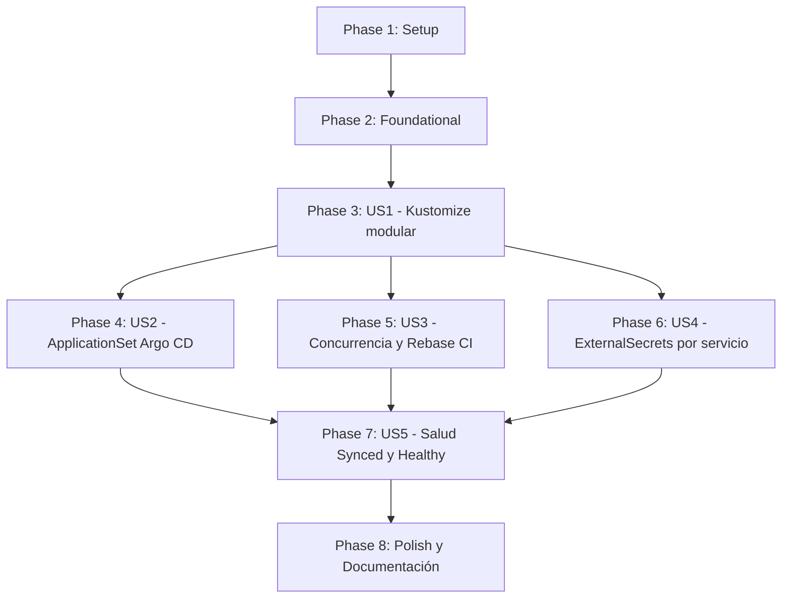

# Tasks: Despliegue por servicio en dev con ApplicationSet

**Input**: Design documents from `/specs/LAB-104-dev-deployment-applicationset/`  
**Prerequisites**: [plan.md](file:///C:/Users/Leandro/IdeaProjects/shoplab-helpdesk/specs/LAB-104-dev-deployment-applicationset/plan.md), [spec.md](file:///C:/Users/Leandro/IdeaProjects/shoplab-helpdesk/specs/LAB-104-dev-deployment-applicationset/spec.md), [research.md](file:///C:/Users/Leandro/IdeaProjects/shoplab-helpdesk/specs/LAB-104-dev-deployment-applicationset/research.md), [data-model.md](file:///C:/Users/Leandro/IdeaProjects/shoplab-helpdesk/specs/LAB-104-dev-deployment-applicationset/data-model.md), [contracts/](file:///C:/Users/Leandro/IdeaProjects/shoplab-helpdesk/specs/LAB-104-dev-deployment-applicationset/contracts/), [quickstart.md](file:///C:/Users/Leandro/IdeaProjects/shoplab-helpdesk/specs/LAB-104-dev-deployment-applicationset/quickstart.md)

---

## Format: `[ID] [P?] [Story] Description`

- **[P]**: Ejecutable en paralelo (archivos independientes, sin dependencias mutuas ni colisiones de estado)
- **[Story]**: Historia de usuario correspondiente (`US1`, `US2`, `US3`, `US4`, `US5`)
- Rutas explícitas con prefijo del repositorio correspondiente (`shoplab-infra/`, `shoplab-ci/` o `docs/`)

---

## Phase 1: Setup (Shared Infrastructure)

**Purpose**: Preparación del entorno de trabajo y estructura base de directorios en `shoplab-infra`.

- [x] T001 Clonar y verificar la línea base del repositorio `shoplab-infra` en la rama `main`
- [x] T002 [P] Crear la estructura de directorios raíz `apps/` y `k8s/bootstrap/` en `shoplab-infra`
- [x] T003 [P] Verificar la disponibilidad local de herramientas CLI (`kustomize` v5.4+, `kubectl` v1.28+, `git`)

---

## Phase 2: Foundational (Blocking Prerequisites)

**Purpose**: Configuración de políticas transversales, namespaces y operadores requeridos por todas las historias de usuario.

**⚠️ CRITICAL**: Ningún microservicio puede desplegarse de forma autónoma sin completar esta base.

- [x] T004 Configurar el namespace `shoplab-dev` y sus labels de gobernanza en `shoplab-infra/k8s/overlays/dev/namespace.yaml`
- [x] T005 [P] Configurar el recurso `ClusterSecretStore` para External Secrets Operator en `shoplab-infra/k8s/bootstrap/secret-store.yaml`
- [x] T006 [P] Actualizar el script de políticas `shoplab-infra/scripts/policy-check.sh` para soportar la validación recursiva de directorios en `apps/`

**Checkpoint**: Base de infraestructura lista: namespace dev, gestor de secretos y políticas operativas.

---

## Phase 3: User Story 1 - Estructura modular de Kustomize por servicio (Priority: P1) 🎯 MVP

**Goal**: Establecer la estructura modular Kustomize en `apps/<servicio>/base` y `apps/<servicio>/overlays/dev` para cada microservicio del bloque de extracción temprana, garantizando manifiestos desacoplados sin tags `:latest`.

**Independent Test**: Ejecutar `kustomize build apps/<servicio>/overlays/dev` para cada servicio y verificar que genera manifiestos válidos con namespace `shoplab-dev`, probes HTTP, límites de recursos y labels de trazabilidad.

### Implementation for User Story 1

- [x] T007 [US1] Crear la plantilla canónica de microservicio en `shoplab-infra/apps/_template/base/` con `deployment.yaml`, `service.yaml`, `kustomization.yaml` y `externalsecret.yaml` conforme a [service-k8s-structure-contract.md](file:///C:/Users/Leandro/IdeaProjects/shoplab-helpdesk/specs/LAB-104-dev-deployment-applicationset/contracts/service-k8s-structure-contract.md)
- [x] T008 [P] [US1] Implementar la base y overlay dev para `chat-service` en `shoplab-infra/apps/chat-service/base/` y `shoplab-infra/apps/chat-service/overlays/dev/`
- [x] T009 [P] [US1] Implementar la base y overlay dev para `retrieval-service` en `shoplab-infra/apps/retrieval-service/base/` y `shoplab-infra/apps/retrieval-service/overlays/dev/`
- [x] T010 [P] [US1] Implementar la base y overlay dev para `eval-service` en `shoplab-infra/apps/eval-service/base/` y `shoplab-infra/apps/eval-service/overlays/dev/`
- [x] T011 [US1] Adaptar la configuración de coexistencia del monolito `backend` durante la transición en `shoplab-infra/apps/backend/` asegurando que no colisionen puertos ni selectores de Service
- [x] T012 [US1] Ejecutar validación de `kustomize build` y `policy-check.sh` sobre todos los overlays en `apps/*/overlays/dev` certificando cero tags `:latest`

**Checkpoint**: User Story 1 completada y validada independientemente.

---

## Phase 4: User Story 2 - ApplicationSet de Argo CD con generador de directorios Git (Priority: P1)

**Goal**: Desplegar el `ApplicationSet` de Argo CD en `shoplab-infra` con generador Git de directorios (`apps/*/overlays/dev`), sincronización automática (`automated: { prune: true, selfHeal: true }`) y `targetRevision: main`.

**Independent Test**: Aplicar el ApplicationSet en el clúster dev y verificar que Argo CD descubre automáticamente cada carpeta en `apps/` creando su `Application` correspondiente; comprobar que añadir una carpeta efímera (`apps/dummy-service`) crea la app y borrarla la elimina limpiamente.

### Implementation for User Story 2

- [x] T013 [US2] Crear el manifiesto del `ApplicationSet` en `shoplab-infra/k8s/bootstrap/applicationset-services-dev.yaml` conforme a [applicationset-contract.yaml](file:///C:/Users/Leandro/IdeaProjects/shoplab-helpdesk/specs/LAB-104-dev-deployment-applicationset/contracts/applicationset-contract.yaml)
- [x] T014 [US2] Configurar las políticas de sincronización `automated` con `prune: true`, `selfHeal: true`, `CreateNamespace=true` y `targetRevision: main`
- [x] T015 [US2] Aplicar el ApplicationSet en el clúster de desarrollo y verificar que el controlador genera las Applications `chat-service-dev`, `retrieval-service-dev` y `eval-service-dev`
- [x] T016 [US2] Ejecutar prueba de alta y baja desatendida creando y eliminando un servicio dummy en `apps/dummy-service/overlays/dev/` verificando el ciclo de vida sin tocar Argo CD

**Checkpoint**: User Story 2 completada y verificada en el clúster dev.

---

## Phase 5: User Story 3 - Despliegue concurrente desacoplado con rebase y reintento en CI (Priority: P1)

**Goal**: Dotar al script de despliegue de soporte para ejecuciones concurrentes entre múltiples microservicios mediante `git pull --rebase origin main` y bucle de reintentos exponenciales con jitter, evitando pérdida de commits o fallos de push.

**Independent Test**: Ejecutar dos llamadas simultáneas a `deploy-service.sh` para dos servicios distintos simulando colisión en el push; comprobar que ambas resuelven el conflicto rebasando limpiamente y ambos commits quedan registrados en `main`.

### Implementation for User Story 3

- [x] T017 [US3] Implementar el script `shoplab-infra/scripts/deploy-service.sh` con soporte de `kustomize edit set image`, validación previa con `kustomize build` y política de rebase con 3 reintentos conforme a [deploy-rebase-contract.md](file:///C:/Users/Leandro/IdeaProjects/shoplab-helpdesk/specs/LAB-104-dev-deployment-applicationset/contracts/deploy-rebase-contract.md)
- [x] T018 [US3] Crear suite de pruebas automatizada en `shoplab-infra/tests/deploy-rebase.test.sh` que simule concurrencia de commits sobre ramas remotas y verifique la resolución no destructiva
- [x] T019 [US3] Actualizar el job reutilizable de despliegue en `shoplab-ci/.github/workflows/deploy.yml` para invocar `deploy-service.sh` con el token de GitHub App `shoplab-deploy`

**Checkpoint**: User Story 3 completada y probada bajo concurrencia.

---

## Phase 6: User Story 4 - Aprovisionamiento seguro de credenciales con `ExternalSecret` por servicio (Priority: P1)

**Goal**: Garantizar que cada microservicio obtenga las credenciales exclusivas de su esquema PostgreSQL mediante un `ExternalSecret` dedicado, sin contraseñas en Git y respetando la soberanía de datos (ADR-0015, ADR-0031).

**Independent Test**: Desplegar los `ExternalSecret` en `shoplab-dev` y verificar que External Secrets Operator materializa los Kubernetes Secrets `<servicio>-db-secret` con las claves `SPRING_DATASOURCE_USERNAME`, `SPRING_DATASOURCE_PASSWORD` y `SPRING_DATASOURCE_URL`.

### Implementation for User Story 4

- [x] T020 [US4] Configurar `apps/chat-service/base/externalsecret.yaml` apuntando a `shoplab/dev/chat-service/database`
- [x] T021 [P] [US4] Configurar `apps/retrieval-service/base/externalsecret.yaml` apuntando a `shoplab/dev/retrieval-service/database`
- [x] T022 [P] [US4] Configurar `apps/eval-service/base/externalsecret.yaml` apuntando a `shoplab/dev/eval-service/database`
- [x] T023 [US4] Validar que los `Deployment` montan las variables de entorno de base de datos desde `<servicio>-db-secret` y comprobar que no existen credenciales hardcodeadas en Git

**Checkpoint**: User Story 4 completada y validada con External Secrets Operator.

---

## Phase 7: User Story 5 - Monitorización, salud y convergencia Synced y Healthy en dev (Priority: P2)

**Goal**: Asegurar que todas las aplicaciones generadas por el ApplicationSet alcancen los estados `Synced` y `Healthy` en Argo CD, configurando probes HTTP y timeouts de sincronización.

**Independent Test**: Ejecutar `argocd app list -l app.kubernetes.io/part-of=shoplab` y verificar que todos los microservicios activos reportan `Synced` y `Healthy`.

### Implementation for User Story 5

- [x] T024 [US5] Configurar `livenessProbe` y `readinessProbe` HTTP apuntando a `/actuator/health/liveness` y `/actuator/health/readiness` en el puerto 8080 en cada `deployment.yaml`
- [x] T025 [US5] Configurar anotaciones de salud y retry backoff en el `ApplicationSet` para tolerar arranques lentos de pods
- [x] T026 [US5] Verificar con `argocd app list` que todas las aplicaciones de desarrollo reportan `Synced` y `Healthy` en el clúster

**Checkpoint**: User Story 5 completada; observabilidad de despliegue en verde.

---

## Phase 8: Polish & Cross-Cutting Concerns

**Purpose**: Documentación operativa, actualización de contratos transversales y validación final de extremo a extremo.

- [x] T027 [P] Actualizar la guía oficial de entrega continua en `docs/despliegue-continuo.md` documentando el flujo de ApplicationSet y el alta de microservicios
- [x] T028 [P] Actualizar las referencias de despliegue e infraestructura en `docs/mapa-servicios.md`
- [x] T029 Ejecutar el ciclo de pruebas completo guiado por [quickstart.md](file:///C:/Users/Leandro/IdeaProjects/shoplab-helpdesk/specs/LAB-104-dev-deployment-applicationset/quickstart.md)
- [x] T030 Validar y completar el checklist de requerimientos en `specs/LAB-104-dev-deployment-applicationset/checklists/requirements.md`

---

## Dependencies & Execution Order

### Phase Dependencies

### Opportunities for Parallel Execution

- En **Phase 3 (US1)**: Las bases y overlays de `chat-service` (T008), `retrieval-service` (T009) y `eval-service` (T010) pueden desarrollarse simultáneamente por ser archivos independientes.
- **Phase 4 (US2)** y **Phase 5 (US3)**: Pueden ejecutarse en paralelo una vez completada la estructura Kustomize de US1.
- En **Phase 6 (US4)**: Los manifiestos de `ExternalSecret` (T020, T021, T022) son totalmente paralelizables.
- En **Phase 8 (Polish)**: La actualización de documentación (`despliegue-continuo.md` y `mapa-servicios.md`) puede realizarse en paralelo.
