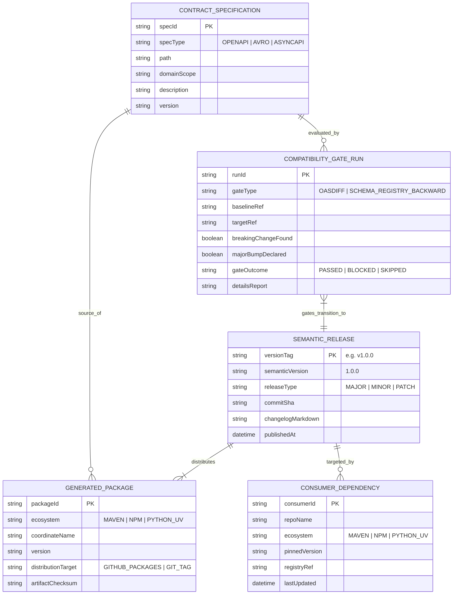
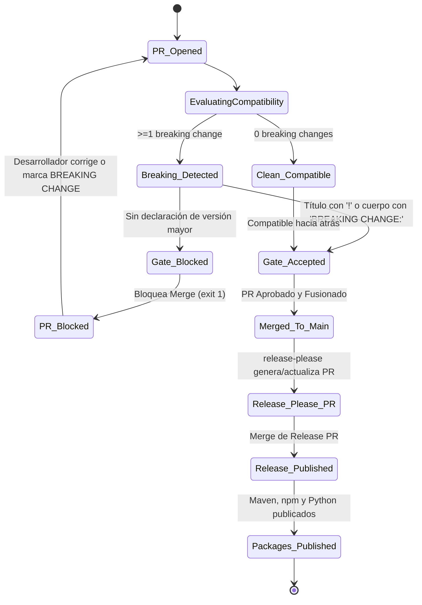

# Data Model: Repo shoplab-contracts publicado como paquetes versionados

**Feature**: `LAB-108-contracts-versioned-packages`  
**Date**: 2026-11-23  
**Status**: Completed  

---

## 1. Overview

Esta especificación de modelo de datos formaliza las entidades que componen el ciclo de vida de los contratos en el repositorio `shoplab-contracts`, desde la definición de la especificación física hasta su validación en CI, versionado por `release-please`, publicación en los tres registros (Maven, npm, Python) y adopción en los servicios consumidores.

---

## 2. Diagrama de Relaciones de Entidades

---

## 3. Especificación de Entidades

### 3.1. Entity: `ContractSpecification` (Especificación de Contrato)
Representa un archivo de contrato formal almacenado en el repositorio `shoplab-contracts`.

| Campo | Tipo | Restricciones | Descripción |
|---|---|---|---|
| `specId` | String | Único, kebab-case | Identificador lógico de la especificación (ej. `common-api-v1`). |
| `specType` | Enum | `OPENAPI`, `AVRO`, `ASYNCAPI` | Tipo de especificación. Determina qué validador y generador se aplica. |
| `path` | String | Ruta relativa | Ruta en el repositorio (ej. `openapi/common/v1/common-api.yaml`). |
| `domainScope` | String | No nulo | Dominio o módulo al que aplica (ej. `common`, `tickets`, `chat`). |
| `version` | String | SemVer | Versión de la especificación declarada en el documento OpenAPI o esquema. |

### 3.2. Entity: `CompatibilityGateRun` (Ejecución de la Puerta de Compatibilidad)
Representa el resultado de la evaluación de compatibilidad de un PR contra la versión base.

| Campo | Tipo | Restricciones | Descripción |
|---|---|---|---|
| `runId` | String | UUID / GitHub Run ID | Identificador de la ejecución en CI. |
| `gateType` | Enum | `OASDIFF`, `SCHEMA_REGISTRY_BACKWARD` | Herramienta y regla de validación ejecutada. |
| `baselineRef` | String | Tag git o commit SHA | Referencia de línea base contra la que se evalúa el cambio (ej. `v1.0.0` o `origin/main`). |
| `breakingChangeFound`| Boolean | No nulo | `true` si se detectó una ruptura sintáctica o semántica retroactiva. |
| `majorBumpDeclared` | Boolean | No nulo | `true` si el PR incluye `!` o `BREAKING CHANGE:` solicitando incremento de versión mayor. |
| `gateOutcome` | Enum | `PASSED`, `BLOCKED`, `SKIPPED` | Resultado final del gate. Bloquea el merge si `breakingChangeFound == true && majorBumpDeclared == false`. |
| `detailsReport` | Text | Opcional | Registro detallado de diferencias y cambios incompatibles detectados. |

### 3.3. Entity: `SemanticRelease` (Release Semántica)
Representa un corte de versión inmutable generado automáticamente por `release-please`.

| Campo | Tipo | Restricciones | Descripción |
|---|---|---|---|
| `versionTag` | String | Formato `vX.Y.Z` | Tag git creado (ej. `v1.0.0`, `v1.1.0`, `v2.0.0`). |
| `semanticVersion` | String | Formato `X.Y.Z` | Versión numérica sin prefijo `v`. |
| `releaseType` | Enum | `MAJOR`, `MINOR`, `PATCH` | Nivel de incremento según los tipos de commits incluidos. |
| `commitSha` | String | SHA-1 / SHA-256 | Commit exacto en `main` asociado a la release. |
| `changelogMarkdown`| Text | Markdown | Sección de notas de la release generada desde Conventional Commits. |
| `publishedAt` | Timestamp | ISO 8601 | Fecha y hora de creación de la release. |

### 3.4. Entity: `GeneratedPackage` (Paquete Distribuido)
Representa la unidad de distribución binaria o tipada generada a partir de los contratos para un ecosistema específico.

| Campo | Tipo | Restricciones | Descripción |
|---|---|---|---|
| `packageId` | String | Único | Identificador del artefacto generado. |
| `ecosystem` | Enum | `MAVEN`, `NPM`, `PYTHON_UV` | Ecosistema destino del paquete. |
| `coordinateName` | String | No nulo | Coordenada o nombre del paquete (ej. `com.shoplab:shoplab-contracts`, `@leandroamariles/shoplab-contracts`, `shoplab-contracts`). |
| `version` | String | SemVer | Versión del paquete (debe coincidir exactamente con `SemanticRelease.semanticVersion`). |
| `distributionTarget`| Enum | `GITHUB_PACKAGES_MAVEN`, `GITHUB_PACKAGES_NPM`, `GIT_TAG` | Ubicación donde reside el paquete para consumo. |
| `artifactChecksum` | String | SHA-256 | Suma de comprobación para verificación de integridad. |

### 3.5. Entity: `ConsumerDependency` (Fijación de Dependencia en Consumidor)
Representa el vínculo de un servicio consumidor con una versión inmutable de `shoplab-contracts`.

| Campo | Tipo | Restricciones | Descripción |
|---|---|---|---|
| `consumerId` | String | Identificador | Servicio o módulo consumidor (ej. `shoplab-helpdesk/backend`, `frontend`, microservicio futuro). |
| `ecosystem` | Enum | `MAVEN`, `NPM`, `PYTHON_UV` | Gestor de dependencias del consumidor. |
| `pinnedVersion` | String | Versión exacta (sin `^`, `~`) | Versión declarada en `pom.xml`, `package.json` o `pyproject.toml`. |
| `registryRef` | String | URL | Registro configurado con credenciales de lectura en el consumidor. |
| `lastUpdated` | Timestamp | ISO 8601 | Última actualización aprobada por PR de Dependabot o manual. |

---

## 4. Máquinas de Estados

### 4.1. Ciclo de Vida de un PR de Contrato (Compatibility Gate)

