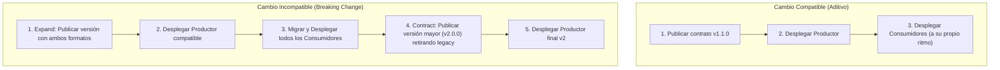

# Quickstart Guide: Publicación y Consumo de Contratos Versionados

**Feature**: `LAB-108-contracts-versioned-packages`  
**Target Repository**: `shoplab-contracts` & Consumidores  
**Date**: 2026-11-23  

---

## 1. Introducción

El repositorio `shoplab-contracts` es la única fuente de verdad para los contratos síncronos (OpenAPI) y asíncronos (Avro / AsyncAPI) de ShopLab Helpdesk. Este documento explica cómo proponer un cambio, verificarlo localmente, publicarlo mediante `release-please` y consumirlo en Java (Maven), Angular (npm) y Python (`uv`).

---

## 2. Flujo de Trabajo para Desarrolladores

### 2.1. Clonar el Repositorio de Contratos

```bash
git clone https://github.com/leandroAmariles/shoplab-contracts.git
cd shoplab-contracts
git checkout -b feature/LAB-xxx-descripcion-del-contrato
```

### 2.2. Tipos de Cambios de Contrato

| Tipo de Cambio | Ejemplo | Impacto SemVer | Convención de Commit / PR |
|---|---|---|---|
| **Compatible (Aditivo)** | Añadir endpoint, añadir campo opcional, añadir valor enum compatible | `minor` (feat) o `patch` (fix) | `feat(tickets): [LAB-xxx] add priority field` |
| **Incompatible (Breaking)** | Eliminar endpoint, renombrar campo, cambiar tipo, hacer campo obligatorio | `major` (X+1.0.0) | `feat(tickets)!: [LAB-xxx] remove legacy status field`<br>o `BREAKING CHANGE:` en el cuerpo |

---

## 3. Verificación Local antes del PR

### 3.1. Validar Compatibilidad con `oasdiff`

Para comprobar si tus cambios en `openapi/` rompen la compatibilidad hacia atrás frente a la última versión publicada:

```bash
# Comparar el contrato modificado contra la rama main o el último tag
oasdiff breaking origin/main openapi/common/v1/common-api.yaml
```

- Si el resultado es **vacío**: El cambio es retrocompatible.
- Si reporta **breaking changes**: Debes añadir el marcador `!` en el título del PR para permitir el incremento de versión mayor.

### 3.2. Probar Generación de Paquetes en Seco (Dry-Run)

```bash
# Probar compilación Maven de las clases Java generadas
cd generators/java && mvn clean compile && cd ../..

# Probar generación y compilación del paquete npm
cd generators/npm && npm ci && npm run build && cd ../..

# Probar compilación del paquete Python
cd generators/python && uv build && cd ../..
```

---

## 4. Publicación Automática con `release-please`

1. **Abrir Pull Request**:
   - Título siguiendo Conventional Commits: `feat(scope): [LAB-xxx] descripcion` (o `feat(scope)!: ...` si es breaking).
   - La CI ejecuta automáticamente `oasdiff`, validación Avro (omite si `avro/` está vacío) y dry-run de empaquetado.
2. **Fusión en `main`**:
   - Una vez aprobado y fusionado, la acción `release-please` analiza los commits y abre (o actualiza) un PR de release titulado `chore: release vX.Y.Z`.
3. **Aprobar y Fusionar el PR de Release**:
   - Al fusionar el PR de release, `release-please` crea el tag Git inmutable `vX.Y.Z` y el GitHub Release.
   - El workflow `publish.yml` se dispara automáticamente y:
     - Publica `com.shoplab:shoplab-contracts:X.Y.Z` en GitHub Packages Maven.
     - Publica `@leandroamariles/shoplab-contracts@X.Y.Z` en GitHub Packages npm.
     - Deja el tag git `vX.Y.Z` listo para ser resuelto por `uv`.

---

## 5. Cómo Consumir los Paquetes en cada Stack

### 5.1. Backend Java (Maven)

1. En `backend/pom.xml`, configurar el repositorio y la dependencia fijada:
   ```xml
   <repositories>
       <repository>
           <id>github-shoplab-contracts</id>
           <url>https://maven.pkg.github.com/leandroAmariles/shoplab-contracts</url>
       </repository>
   </repositories>

   <dependencies>
       <dependency>
           <groupId>com.shoplab</groupId>
           <artifactId>shoplab-contracts</artifactId>
           <version>1.0.0</version>
       </dependency>
   </dependencies>
   ```
2. Asegurar que `~/.m2/settings.xml` contiene las credenciales de GitHub Packages:
   ```xml
   <servers>
       <server>
           <id>github-shoplab-contracts</id>
           <username>tu-usuario-github</username>
           <password>${env.GITHUB_TOKEN}</password>
       </server>
   </servers>
   ```

### 5.2. Frontend Angular (npm)

1. En la raíz o en `frontend/`, crear o verificar `.npmrc`:
   ```ini
   @leandroamariles:registry=https://npm.pkg.github.com
   //npm.pkg.github.com/:_authToken=${GITHUB_TOKEN}
   ```
2. Instalar la versión exacta fijada:
   ```bash
   npm install @leandroamariles/shoplab-contracts@1.0.0 --save-exact
   ```

### 5.3. Servicios Python (`uv`)

Instalar el paquete directamente apuntando al tag inmutable:
```bash
uv add "shoplab-contracts @ git+https://github.com/leandroAmariles/shoplab-contracts.git@v1.0.0"
```
O en `pyproject.toml`:
```toml
[project]
dependencies = [
    "shoplab-contracts @ git+https://github.com/leandroAmariles/shoplab-contracts.git@v1.0.0"
]
```

---

## 6. Orden de Despliegue Productor vs. Consumidor (Regla de Oro)

Para evitar caídas de servicio en tiempo de ejecución:


