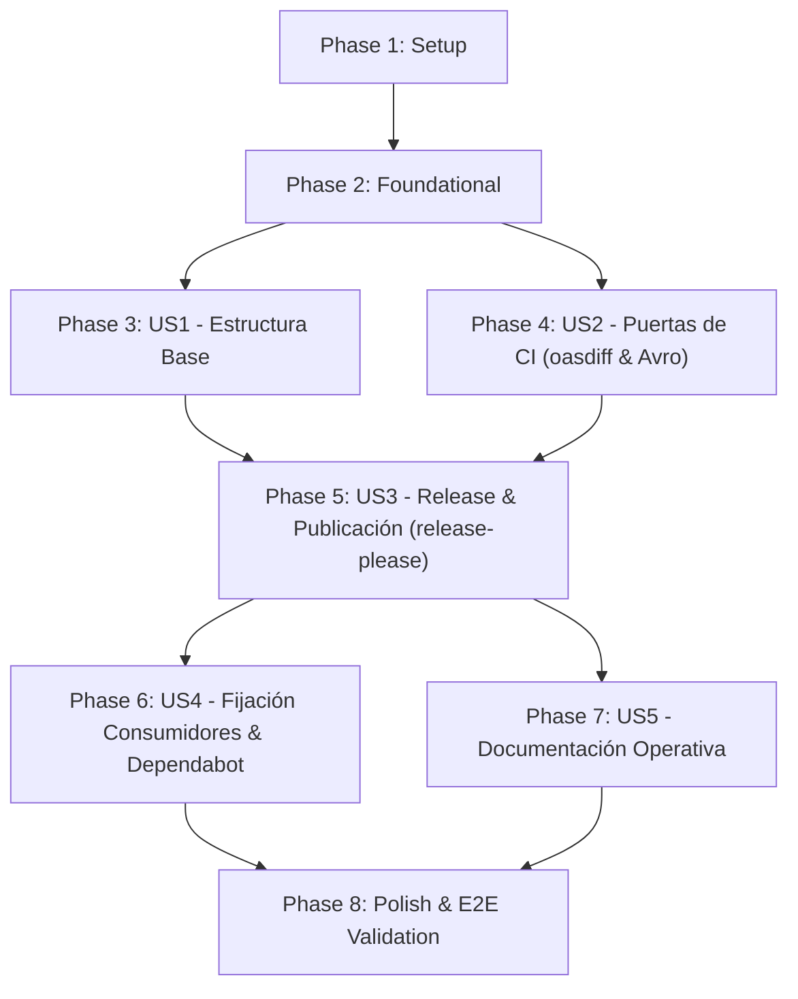

# Tasks: Repo shoplab-contracts publicado como paquetes versionados

**Input**: Design documents from `/specs/LAB-108-contracts-versioned-packages/`  
**Prerequisites**: [plan.md](file:///C:/Users/Leandro/IdeaProjects/shoplab-helpdesk/specs/LAB-108-contracts-versioned-packages/plan.md), [spec.md](file:///C:/Users/Leandro/IdeaProjects/shoplab-helpdesk/specs/LAB-108-contracts-versioned-packages/spec.md), [research.md](file:///C:/Users/Leandro/IdeaProjects/shoplab-helpdesk/specs/LAB-108-contracts-versioned-packages/research.md), [data-model.md](file:///C:/Users/Leandro/IdeaProjects/shoplab-helpdesk/specs/LAB-108-contracts-versioned-packages/data-model.md), [contracts/](file:///C:/Users/Leandro/IdeaProjects/shoplab-helpdesk/specs/LAB-108-contracts-versioned-packages/contracts/), [quickstart.md](file:///C:/Users/Leandro/IdeaProjects/shoplab-helpdesk/specs/LAB-108-contracts-versioned-packages/quickstart.md)

---

## Format: `[ID] [P?] [Story] Description`

- **[P]**: Ejecutable en paralelo (archivos independientes, sin dependencias mutuas)
- **[Story]**: Historia de usuario correspondiente (`US1`, `US2`, `US3`, `US4`, `US5`)
- Rutas explícitas para cada repositorio (`shoplab-contracts/` o `shoplab-helpdesk/`)

---

## Phase 1: Setup (Shared Infrastructure)

**Purpose**: Inicialización del espacio de trabajo y estructura base del repositorio `shoplab-contracts`.

- [x] T001 Inicializar el directorio y repositorio Git `shoplab-contracts` con ramas principales y configuración `.gitignore` en `shoplab-contracts/.gitignore`
- [x] T002 [P] Crear archivo `README.md` y licencia `LICENSE` en la raíz de `shoplab-contracts/`
- [x] T003 [P] Configurar el linter y reglas de formato para YAML, Markdown y JSON en `shoplab-contracts/.editorconfig` y `.github/linters/`

---

## Phase 2: Foundational (Blocking Prerequisites)

**Purpose**: Infraestructura básica y contratos semilla que desbloquean la validación en CI y los generadores de código.

**⚠️ CRITICAL**: Ninguna historia de usuario puede completarse sin esta base.

- [x] T004 Crear el árbol de carpetas de especificaciones `openapi/`, `avro/` y `asyncapi/` con `.gitkeep` en `shoplab-contracts/avro/.gitkeep` y `shoplab-contracts/asyncapi/.gitkeep`
- [x] T005 [P] Crear el contrato OpenAPI 3.1 semilla en `shoplab-contracts/openapi/common/v1/common-api.yaml` con endpoints `/health`, `/ping` y esquemas `HealthStatus`, `PingResponse`, `ErrorDto` y `ErrorResponse` (definido en [common-api-seed.yaml](file:///C:/Users/Leandro/IdeaProjects/shoplab-helpdesk/specs/LAB-108-contracts-versioned-packages/contracts/common-api-seed.yaml))
- [x] T006 [P] Configurar workflow de validación de Conventional Commits en PRs en `shoplab-contracts/.github/workflows/pr-title.yml`
- [x] T007 Configurar la automatización de dependencias en `shoplab-contracts/.github/dependabot.yml` para GitHub Actions, Maven y npm

**Checkpoint**: Base lista: la estructura de carpetas existe, el contrato semilla está definido y las validaciones de PR están activas.

---

## Phase 3: User Story 1 - Repositorio independiente `shoplab-contracts` con estructura base (Priority: P1) 🎯 MVP

**Goal**: Disponer del repositorio dedicado `shoplab-contracts` con la estructura de contratos sin lógica de dominio ni acoplamiento al monolito.

**Independent Test**: Clonar `shoplab-contracts`, verificar la existencia de `openapi/`, `avro/` y `asyncapi/` (con `avro/` y `asyncapi/` limpios de esquemas hasta LAB-50), confirmar que no contiene dependencias de negocio y validar que construye en limpio.

### Implementation for User Story 1

- [x] T008 [US1] Verificar y certificar que `avro/` y `asyncapi/` en `shoplab-contracts/` no contienen esquemas de eventos de negocio hasta `LAB-50` (solo `.gitkeep`)
- [x] T009 [US1] Configurar script o check de arquitectura en `shoplab-contracts/scripts/verify-contracts-purity.sh` para verificar que el repositorio contiene exclusivamente especificaciones de contrato y configuración de generación, sin código de dominio
- [x] T010 [US1] Configurar reglas de protección de rama `main` en `shoplab-contracts` (exigiendo PR, status checks de CI y revisión aprobada equivalente a LAB-77)

**Checkpoint**: User Story 1 completada y validada independientemente.

---

## Phase 4: User Story 2 - Validación de compatibilidad de contratos en CI (`oasdiff` y Avro `BACKWARD`) (Priority: P1)

**Goal**: Garantizar que cada PR valide automáticamente la sintaxis y compatibilidad hacia atrás con `oasdiff` y Avro Schema Registry `BACKWARD`, bloqueando rupturas no declaradas como cambio mayor.

**Independent Test**: Ejecutar pruebas de PR con (a) cambio OpenAPI compatible (pasa en verde), (b) cambio OpenAPI incompatible sin versión mayor (falla y bloquea), (c) cambio incompatible con `!` o `BREAKING CHANGE:` (pasa con aviso de versión mayor), (d) ejecución con `avro/` vacío (omite limpiamente).

### Implementation for User Story 2

- [x] T011 [US2] Implementar script de validación de compatibilidad OpenAPI `shoplab-contracts/scripts/check-openapi-compatibility.sh` usando `tufin/oasdiff`:
  - Obtiene la especificación de referencia desde el último tag `vX.Y.Z` o `origin/main`
  - Ejecuta `oasdiff breaking`
  - Evalúa si el título o cuerpo del commit/PR contiene indicador de cambio mayor (`!` o `BREAKING CHANGE:`)
  - Retorna exit code 0 o 1 según la matriz definida en [ci-validation-workflow-contract.md](file:///C:/Users/Leandro/IdeaProjects/shoplab-helpdesk/specs/LAB-108-contracts-versioned-packages/contracts/ci-validation-workflow-contract.md)
- [x] T012 [US2] Implementar script de compatibilidad Avro `shoplab-contracts/scripts/check-avro-compatibility.sh`:
  - Detecta si existen archivos `.avsc` en `avro/`
  - Si no existen esquemas: emite log informativo `"No Avro schemas found in avro/; skipping Schema Registry compatibility check"` y termina exitoso (`exit 0`)
  - Si existen esquemas: valida compatibilidad `BACKWARD` contra Schema Registry efímero o CLI de compatibilidad
- [x] T013 [P] [US2] Crear pruebas unitarias y fixtures de verificación en `shoplab-contracts/tests/compatibility/` para comprobar que `check-openapi-compatibility.sh` y `check-avro-compatibility.sh` rechazan roturas y aceptan cambios compatibles o breaking debidamente marcados
- [x] T014 [US2] Integrar los pasos de validación en el workflow principal de CI en `shoplab-contracts/.github/workflows/ci.yml`

**Checkpoint**: User Story 2 completada: las puertas de compatibilidad para OpenAPI y Avro bloquean cambios no autorizados en CI.

---

## Phase 5: User Story 3 - Release automático y publicación de paquetes Maven, npm y Python (Priority: P1)

**Goal**: Gestionar el versionado semántico con `release-please` y publicar automáticamente los artefactos Maven y npm en GitHub Packages y el paquete Python por tag git `@vX.Y.Z` con `uv`.

**Independent Test**: Fusionar un cambio en `main`, fusionar el PR de release generado por `release-please` creando el tag `v1.0.0` y verificar la existencia e instalación de los tres paquetes (Maven en GitHub Packages, npm en GitHub Packages, Python vía `uv add git+...@v1.0.0`).

### Implementation for User Story 3

- [x] T015 [US3] Configurar `release-please` en `shoplab-contracts/release-please-config.json` con `"bump-minor-pre-major": false`, versión inicial `"1.0.0"` y `.release-please-manifest.json`
- [x] T016 [US3] Crear el workflow de release en `shoplab-contracts/.github/workflows/release-please.yml` con permisos de contenidos y PRs usando `googleapis/release-please-action`
- [x] T017 [P] [US3] Configurar el generador Java/Maven en `shoplab-contracts/generators/java/pom.xml`:
  - `openapi-generator-maven-plugin` para generar DTOs y modelos Java
  - Coordenadas `com.shoplab:shoplab-contracts`
  - `distributionManagement` apuntando a `https://maven.pkg.github.com/leandroAmariles/shoplab-contracts`
- [x] T018 [P] [US3] Configurar el generador npm en `shoplab-contracts/generators/npm/package.json`:
  - Generación del cliente Angular TypeScript (`@openapitools/openapi-generator-cli`)
  - Nombre `@leandroamariles/shoplab-contracts`
  - Script de compilación y publicación a `https://npm.pkg.github.com`
- [x] T019 [P] [US3] Configurar el paquete Python en `shoplab-contracts/generators/python/pyproject.toml`:
  - Build backend `hatchling`
  - Generación de modelos Pydantic v2 a partir de OpenAPI (`datamodel-code-generator`)
  - Estructura instalable directamente por URL git y tag `@vX.Y.Z` con `uv`
- [x] T020 [US3] Añadir paso de verificación en seco (dry-run compile) en `shoplab-contracts/.github/workflows/ci.yml` para compilar los generadores Java, npm y Python en cada PR antes del merge
- [x] T021 [US3] Crear el workflow de publicación `shoplab-contracts/.github/workflows/publish.yml`:
  - Se activa ante la creación de releases por `release-please` (`types: [published]`)
  - Ejecuta la publicación del artefacto Maven en GitHub Packages
  - Ejecuta la publicación del paquete npm en GitHub Packages
  - Verifica la integridad del tag git para resolución con `uv`
- [x] T022 [US3] Ejecutar la prueba de publicación extremo a extremo (E2E) con la versión inicial `v1.0.0` y verificar que los tres paquetes están disponibles en sus respectivos registros

**Checkpoint**: User Story 3 completada: release automatizado y paquetes publicados en los tres ecosistemas.

---

## Phase 6: User Story 4 - Fijación de versiones en consumidores y actualización automática con Dependabot (Priority: P2)

**Goal**: Configurar los servicios consumidores para fijar versiones exactas de `shoplab-contracts` y recibir propuestas automáticas de actualización de Dependabot ante nuevas releases.

**Independent Test**: Configurar en `shoplab-helpdesk` una dependencia fijada a `shoplab-contracts:1.0.0` y validar la sintaxis de `.github/dependabot.yml` con los registries de GitHub Packages.

### Implementation for User Story 4

- [x] T023 [P] [US4] Actualizar `.github/dependabot.yml` en `shoplab-helpdesk` para añadir los registros autenticados de GitHub Packages (`github-maven` y `github-npm`) con token `DEPENDABOT_PACKAGES_TOKEN`
- [x] T024 [P] [US4] Configurar la dependencia semilla en `backend/pom.xml` fijando la versión exacta `1.0.0` de `com.shoplab:shoplab-contracts` con el repositorio correspondiente
- [x] T025 [P] [US4] Documentar y verificar el mecanismo de fijación exacta en `frontend/package.json` para `@leandroamariles/shoplab-contracts` y en servicios Python para `uv` (`pyproject.toml`)

**Checkpoint**: User Story 4 completada: consumidores configurados con dependencias inmutables y Dependabot habilitado.

---

## Phase 7: User Story 5 - Documentación del flujo de cambios de contrato y orden de despliegue (Priority: P2)

**Goal**: Publicar en `docs/` una guía operativa exhaustiva que explique cómo proponer, validar y publicar un contrato, y la secuencia de despliegue productor/consumidores.

**Independent Test**: Un desarrollador lee el documento y puede ejecutar el ciclo completo de cambio y determinar el orden de despliegue en cambios compatibles vs. incompatibles.

### Implementation for User Story 5

- [x] T026 [US5] Redactar la guía técnica y operativa en `docs/contratos.md` en `shoplab-helpdesk`:
  - Ciclo de vida de un cambio de contrato (PR, oasdiff, `release-please`, publicación)
  - Autenticación en desarrollo y CI (Maven `.m2/settings.xml`, npm `.npmrc`, Python `uv`)
  - Estrategia de despliegue Expand-and-Contract para cambios compatibles vs. breaking changes
  - Orden estricto de despliegue: Productor primero en aditivos; coexistencia en breaking changes
  - Limitaciones conocidas de Dependabot con tags git en Python
- [x] T027 [US5] Vincular la documentación desde el `README.md` de `shoplab-contracts` y en el índice de arquitectura `docs/modulos.md` de `shoplab-helpdesk`

**Checkpoint**: User Story 5 completada: documentación disponible y referenciada.

---

## Phase 8: Polish & Cross-Cutting Concerns

**Purpose**: Verificación global, pruebas cruzadas y cierre de la historia.

- [x] T028 Ejecutar validación final de todos los acceptance scenarios descritos en [spec.md](file:///C:/Users/Leandro/IdeaProjects/shoplab-helpdesk/specs/LAB-108-contracts-versioned-packages/spec.md)
- [x] T029 [P] Verificar que no existan advertencias ni incidencias de linters en `shoplab-contracts` ni en los archivos modificados de `shoplab-helpdesk`
- [x] T030 Completar el checklist de requerimientos en [requirements.md](file:///C:/Users/Leandro/IdeaProjects/shoplab-helpdesk/specs/LAB-108-contracts-versioned-packages/checklists/requirements.md)

---

## Dependencies & Execution Order

### Phase Dependencies

