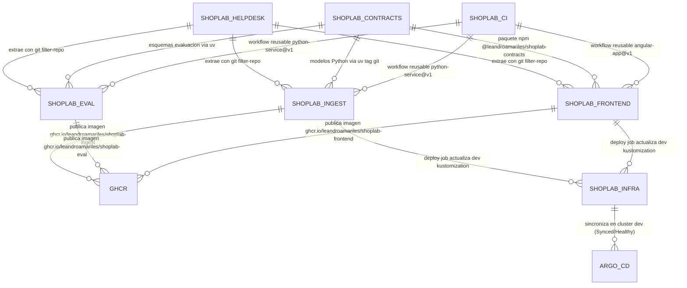

# Data Model & Infrastructure Metadata: Separar ingest, eval y frontend

**Feature**: `LAB-109-separate-ingest-eval-frontend`
**Date**: 2026-11-24
**Status**: Completed

---

## 1. Entidades del Ecosistema Desacoplado



---

## 2. Metadatos de Repositorios de GitHub

### Configuración por Repositorio

| Atributo | `shoplab-ingest` | `shoplab-eval` | `shoplab-frontend` |
|---|---|---|---|
| **Owner** | `leandroAmariles` | `leandroAmariles` | `leandroAmariles` |
| **Visibilidad** | Public | Public | Public |
| **Rama por defecto** | `main` | `main` | `main` |
| **Ruleset `main`** | `require_linear_history`, `pull_request`, checks: `ci-gate` | `require_linear_history`, `pull_request`, checks: `ci-gate` | `require_linear_history`, `pull_request`, checks: `ci-gate` |
| **Secretos necesarios** | `DEPLOY_APP_ID`, `DEPLOY_APP_PRIVATE_KEY` | `DEPLOY_APP_ID`, `DEPLOY_APP_PRIVATE_KEY` | `DEPLOY_APP_ID`, `DEPLOY_APP_PRIVATE_KEY`, `NODE_AUTH_TOKEN` |

---

## 3. Manifiestos de Despliegue en `shoplab-infra`

### Actualización en `k8s/overlays/dev/kustomization.yaml`

El repositorio `shoplab-infra` administra el estado deseado en Kubernetes mediante Kustomize. Cada servicio extraído dispone de una entrada de imagen en `kustomization.yaml`:

```yaml
apiVersion: kustomize.config.k8s.io/v1beta1
kind: Kustomization

resources:
  - ../../base/ingest
  - ../../base/frontend

images:
  - name: ghcr.io/leandroamariles/shoplab-ingest
    newTag: v1.0.0 # o sha-<commit> promovido
  - name: ghcr.io/leandroamariles/shoplab-frontend
    newTag: v1.0.0 # o sha-<commit> promovido
```

### Contrato de Estado en Argo CD

Para cada componente extraído, la aplicación en Argo CD (`shoplab-infra/k8s/argocd/<app>-dev.yaml`) valida las siguientes propiedades de salud:

| Campo | Valor esperado | Descripción |
|---|---|---|
| `.status.sync.status` | `Synced` | El clúster refleja exactamente el commit de `main` en `shoplab-infra` |
| `.status.health.status` | `Healthy` | Pods en estado `Running`, probes HTTP 200 respondiendo |
| `Deployment.spec.replicas` | `>= 1` | Réplicas listas sin caídas de CrashLoopBackOff |
| `Service.spec.type` | `ClusterIP` | Exposición interna al clúster |
| `Ingress.status.loadBalancer` | Asignado | Enrutamiento HTTP operativo |

---

## 4. Estructura de Dependencias y Bloqueos

### `shoplab-frontend/package.json` (Extracto)
```json
{
  "name": "shoplab-frontend",
  "version": "1.0.0",
  "private": true,
  "dependencies": {
    "@leandroamariles/shoplab-contracts": "1.2.0",
    "@angular/core": "^22.2.6",
    "rxjs": "~7.8.0"
  }
}
```

### `shoplab-ingest/pyproject.toml` (Extracto)
```toml
[project]
name = "shoplab-ingest"
version = "1.0.0"
dependencies = [
    "fastapi>=0.115",
    "uvicorn>=0.32",
    "pydantic-settings>=2.6",
    "pdfplumber>=0.11",
    "markdown-it-py>=3.0",
    "shoplab-contracts @ git+https://github.com/leandroAmariles/shoplab-contracts.git@v1.2.0#subdirectory=python"
]
```
