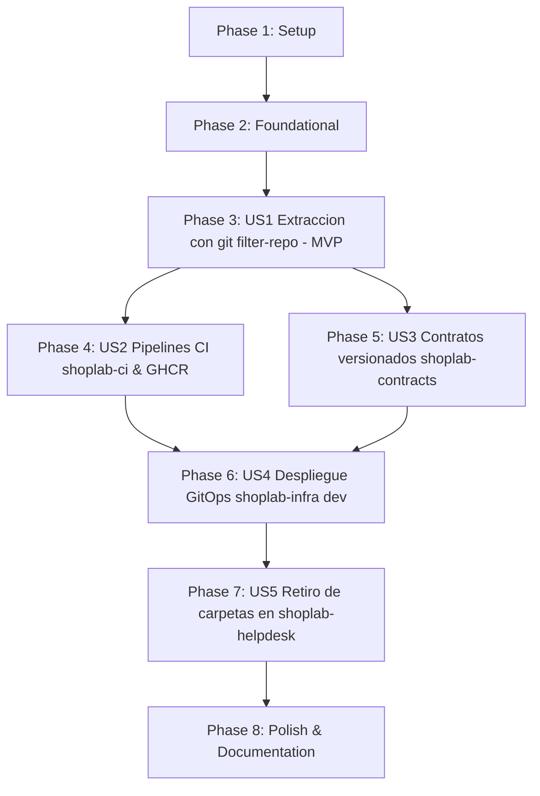

# Tasks: Separar ingest, eval y frontend en repos propios

**Input**: Design documents from `/specs/LAB-109-separate-ingest-eval-frontend/`  
**Prerequisites**: [plan.md](file:///C:/Users/Leandro/IdeaProjects/shoplab-helpdesk/specs/LAB-109-separate-ingest-eval-frontend/plan.md), [spec.md](file:///C:/Users/Leandro/IdeaProjects/shoplab-helpdesk/specs/LAB-109-separate-ingest-eval-frontend/spec.md), [research.md](file:///C:/Users/Leandro/IdeaProjects/shoplab-helpdesk/specs/LAB-109-separate-ingest-eval-frontend/research.md), [data-model.md](file:///C:/Users/Leandro/IdeaProjects/shoplab-helpdesk/specs/LAB-109-separate-ingest-eval-frontend/data-model.md), [contracts/](file:///C:/Users/Leandro/IdeaProjects/shoplab-helpdesk/specs/LAB-109-separate-ingest-eval-frontend/contracts/), [quickstart.md](file:///C:/Users/Leandro/IdeaProjects/shoplab-helpdesk/specs/LAB-109-separate-ingest-eval-frontend/quickstart.md)

---

## Format: `[ID] [P?] [Story] Description`

- **[P]**: Ejecutable en paralelo (archivos independientes, sin colisiones de estado ni dependencias mutuas)
- **[Story]**: Historia de usuario correspondiente (`US1`, `US2`, `US3`, `US4`, `US5`)
- Rutas explícitas para cada repositorio (`shoplab-ingest/`, `shoplab-eval/`, `shoplab-frontend/`, `shoplab-infra/` o `shoplab-helpdesk/`)

---

## Phase 1: Setup (Prerequisites & Repositories Initialization)

**Purpose**: Preparar el entorno de migración y crear los repositorios remotos destino en GitHub.

- [x] T001 Verificar la disponibilidad de `git-filter-repo` localmente y clonar el monorepo en un directorio temporal de trabajo aislado (`/tmp/migration-workspace`) para realizar la partición sin riesgo
- [x] T002 [P] Crear los tres repositorios vacíos en GitHub bajo la cuenta `leandroAmariles`: `shoplab-ingest`, `shoplab-eval` y `shoplab-frontend` con visibilidad pública y rama principal `main`
- [x] T003 [P] Configurar los secretos de GitHub App (`DEPLOY_APP_ID`, `DEPLOY_APP_PRIVATE_KEY`) en `shoplab-ingest`, `shoplab-eval` y `shoplab-frontend` para autorizar despliegues hacia `shoplab-infra`

---

## Phase 2: Foundational (Governance, Versioning & Rulesets)

**Purpose**: Establecer la gobernanza y protección de ramas común a los tres repositorios antes de poblar código.

**⚠️ CRITICAL**: Ningún repositorio debe recibir commits de extracción sin tener las reglas base configuradas.

- [x] T004 Configurar el ruleset de protección en `main` para `shoplab-ingest`, `shoplab-eval` y `shoplab-frontend` (exigir pull request, checks requeridos `ci-gate` y `pr-title`, historial lineal estricto, prohíbe force-push y eliminación de rama)
- [x] T005 [P] Configurar el workflow de validación de títulos Conventional Commits en `.github/workflows/pr-title.yml` en los tres repositorios
- [x] T006 [P] Configurar `release-please` (`release-please-config.json`, `.release-please-manifest.json` y `.github/workflows/release-please.yml`) en los tres repositorios para versionado semántico independiente
- [x] T007 [P] Configurar `.github/dependabot.yml` en los tres repositorios: ecosistema `pip`/`uv` para `shoplab-ingest` y `shoplab-eval`, `npm` para `shoplab-frontend`, y `github-actions` en los tres

**Checkpoint**: Base de gobernanza y protección lista en GitHub para los tres componentes.

---

## Phase 3: User Story 1 - Extracción de repositorios conservando historial con `git filter-repo` (Priority: P1) 🎯 MVP

**Goal**: Extraer limpiamente las subcarpetas `ingest/`, `eval/` y `frontend/` a sus respectivos repositorios independientes conservando el 100 % del historial de commits, autores y fechas mediante `git filter-repo`, dejando los archivos en la raíz del proyecto.

**Independent Test**: Clonar cada uno de los tres repositorios, ejecutar `git log --stat` comprobando la trazabilidad de commits pasados, verificar que los archivos de configuración (`pyproject.toml` o `package.json`) residen en la raíz y ejecutar las suites de pruebas en local (`uv run pytest` o `npm test`).

### Implementation for User Story 1

- [x] T008 [US1] Ejecutar la extracción de `ingest/` hacia `shoplab-ingest`:
  - En `/tmp/ingest-repo`: ejecutar `git filter-repo --subdirectory-filter ingest --force` conforme a [repo-extraction-contract.md](file:///C:/Users/Leandro/IdeaProjects/shoplab-helpdesk/specs/LAB-109-separate-ingest-eval-frontend/contracts/repo-extraction-contract.md)
  - Purgar tags previos del monorepo (`git tag -l | xargs git tag -d`) para iniciar linaje limpio
  - Verificar que los archivos (`app/`, `tests/`, `pyproject.toml`, `Dockerfile`, `uv.lock`) quedan en la raíz
  - Comprobar con `git log` la conservación íntegra de commits históricos y autores
  - Configurar remote `origin` hacia `https://github.com/leandroAmariles/shoplab-ingest.git` y hacer `git push -u origin main --force`
- [x] T009 [P] [US1] Ejecutar la extracción de `eval/` hacia `shoplab-eval`:
  - En `/tmp/eval-repo`: ejecutar `git filter-repo --subdirectory-filter eval --force`
  - Purgar tags previos del monorepo
  - Verificar que los archivos (`src/shoplab_eval/`, `golden.jsonl`, `pyproject.toml`, `tests/`, `uv.lock`) quedan en la raíz
  - Comprobar con `git log` la conservación del historial
  - Configurar remote `origin` hacia `https://github.com/leandroAmariles/shoplab-eval.git` y hacer `git push -u origin main --force`
- [x] T010 [P] [US1] Ejecutar la extracción de `frontend/` hacia `shoplab-frontend`:
  - En `/tmp/frontend-repo`: ejecutar `git filter-repo --subdirectory-filter frontend --force`
  - Purgar tags previos del monorepo
  - Verificar que los archivos (`src/`, `package.json`, `angular.json`, `Dockerfile`, `nginx.conf`) quedan en la raíz
  - Comprobar con `git log` la conservación del historial
  - Configurar remote `origin` hacia `https://github.com/leandroAmariles/shoplab-frontend.git` y hacer `git push -u origin main --force`
- [x] T011 [US1] Validar ejecución local autónoma de pruebas en cada repositorio extraído:
  - En `shoplab-ingest`: ejecutar `uv sync && uv run pytest`
  - En `shoplab-eval`: ejecutar `uv sync && uv run pytest`
  - En `shoplab-frontend`: ejecutar `npm ci && npm test -- --watch=false && npm run build`

**Checkpoint**: User Story 1 completada y verificada independientemente. Los tres repositorios existen con su árbol limpio e historial intacto.

---

## Phase 4: User Story 2 - Pipelines de CI desacoplados con `shoplab-ci`, GHCR, release-please y Dependabot (Priority: P1)

**Goal**: Configurar en cada repositorio su workflow de CI invocando los flujos reutilizables de `shoplab-ci@v1`, publicando imágenes OCI en GHCR con SBOM y firma Cosign keyless, y gestionando releases automáticas.

**Independent Test**: Abrir un Pull Request de prueba en cada repositorio comprobando que corren los checks de CI reutilizables (lint, tests con cobertura ≥80 %, Trivy fs/imagen y políticas de seguridad); fusionar a `main` y verificar que se publica la imagen firmada en `ghcr.io/leandroamariles/<repo>` con tag `:sha-<commit>` y se genera el release PR de `release-please`.

### Implementation for User Story 2

- [x] T012 [US2] Implementar `.github/workflows/ci.yml` en `shoplab-ingest` invocando `leandroAmariles/shoplab-ci/.github/workflows/python-service.yml@v1` conforme a [ci-integration-contract.md](file:///C:/Users/Leandro/IdeaProjects/shoplab-helpdesk/specs/LAB-109-separate-ingest-eval-frontend/contracts/ci-integration-contract.md) (`coverage-threshold: 80`, escaneo Trivy, comprobación de políticas)
- [x] T013 [P] [US2] Implementar `.github/workflows/ci.yml` en `shoplab-eval` invocando `leandroAmariles/shoplab-ci/.github/workflows/python-service.yml@v1`
- [x] T014 [P] [US2] Implementar `.github/workflows/ci.yml` en `shoplab-frontend` invocando `leandroAmariles/shoplab-ci/.github/workflows/angular-app.yml@v1` con build de producción, lint y escaneo Trivy
- [x] T015 [US2] Configurar la publicación y firma de imágenes OCI en GHCR:
  - `ghcr.io/leandroamariles/shoplab-ingest`
  - `ghcr.io/leandroamariles/shoplab-eval`
  - `ghcr.io/leandroamariles/shoplab-frontend`
  - Incluyendo generación de SBOM y firma criptográfica keyless con Cosign (`sigstore/cosign-installer` con identidad OIDC de GitHub Actions)
- [x] T016 [US2] Verificar que `release-please` y Dependabot se encuentran operativos en los tres repositorios, comprobando la generación de PRs de release semántica tras commits convencionales en `main`

**Checkpoint**: User Story 2 completada. Cada repositorio tiene su ciclo de integración, publicación de contenedores seguros y versionado completamente autónomo.

---

## Phase 5: User Story 3 - Consumo de contratos versionados de `shoplab-contracts` (Priority: P1)

**Goal**: Desacoplar todas las dependencias de interfaces y modelos consumiendo exclusivamente los paquetes versionados provistos por `shoplab-contracts` (LAB-108).

**Independent Test**: Verificar que `shoplab-frontend` compila consumiendo `@leandroamariles/shoplab-contracts` desde GitHub Packages, y que `shoplab-ingest` y `shoplab-eval` resuelven sus modelos Python vía `uv` sin acceder a ninguna ruta externa al repositorio.

### Implementation for User Story 3

- [x] T017 [US3] Configurar `.npmrc` y `package.json` en `shoplab-frontend` fijando la dependencia exacta `@leandroamariles/shoplab-contracts: 1.2.0` (o versión estable vigente) desde GitHub Packages (`@leandroamariles:registry=https://npm.pkg.github.com`), inyectando `NODE_AUTH_TOKEN` en CI
- [x] T018 [P] [US3] Actualizar `pyproject.toml` y `uv.lock` en `shoplab-ingest` para consumir los modelos y esquemas desde `shoplab-contracts` por tag git inmutable (`git+https://github.com/leandroAmariles/shoplab-contracts.git@v1.2.0#subdirectory=python`)
- [x] T019 [P] [US3] Actualizar `pyproject.toml` y `uv.lock` en `shoplab-eval` para consumir los contratos de evaluación desde `shoplab-contracts` por tag git
- [x] T020 [US3] Verificar que Dependabot en `shoplab-frontend` evalúa correctamente el registro de GitHub Packages y propone actualizaciones cuando existan nuevas versiones de contratos

**Checkpoint**: User Story 3 completada. Cero dependencias locales o relativas; los contratos se consumen como artefactos empaquetados e inmutables.

---

## Phase 6: User Story 4 - Despliegue continuo GitOps hacia `shoplab-infra` y convergencia en `dev` (Priority: P1)

**Goal**: Conectar el pipeline de entrega continua de cada servicio con `shoplab-infra` mediante la GitHub App `shoplab-deploy` y verificar la convergencia automática en Argo CD en el clúster `dev`.

**Independent Test**: Publicar un release o commit en `main` de `shoplab-ingest` o `shoplab-frontend`, verificar que se genera un commit en `main` de `shoplab-infra` actualizando `kustomization.yaml` con el nuevo tag de imagen, y verificar con `kubectl` o Argo CD que las aplicaciones alcanzan el estado `Synced` y `Healthy`.

### Implementation for User Story 4

- [x] T021 [US4] Integrar el job reutilizable de despliegue en los workflows de `shoplab-ingest` y `shoplab-frontend` utilizando el script `deploy-dev.sh` y el token de la GitHub App `shoplab-deploy` conforme a [gitops-deploy-contract.md](file:///C:/Users/Leandro/IdeaProjects/shoplab-helpdesk/specs/LAB-109-separate-ingest-eval-frontend/contracts/gitops-deploy-contract.md)
- [x] T022 [US4] Actualizar los manifiestos base y overlays en `shoplab-infra/k8s/overlays/dev/kustomization.yaml` para asegurar que las imágenes apuntan a `ghcr.io/leandroamariles/shoplab-ingest` y `ghcr.io/leandroamariles/shoplab-frontend` con tags inmutables
- [x] T023 [US4] Validar la sincronización en Argo CD del clúster `dev`, comprobando que las aplicaciones `ingest` y `frontend` se encuentran `Synced` y que los pods están `Healthy` respondiendo a los endpoints de liveness y readiness

**Checkpoint**: User Story 4 completada. La entrega continua GitOps funciona extremo a extremo hacia el clúster `dev`.

---

## Phase 7: User Story 5 - Retiro de carpetas en `shoplab-helpdesk` y actualización del monorepo (Priority: P2)

**Goal**: Eliminar las carpetas `ingest/`, `eval/` y `frontend/` del monorepo `shoplab-helpdesk`, actualizar la documentación y depurar los workflows de CI para evitar jobs rotos o redundantes.

**Independent Test**: Verificar que las carpetas ya no existen en `shoplab-helpdesk`, que `README.md` enlaza a los nuevos repositorios y que los workflows de CI en GitHub Actions de `shoplab-helpdesk` terminan en verde sin buscar carpetas eliminadas.

### Implementation for User Story 5

- [x] T024 [US5] Eliminar físicamente los directorios `ingest/`, `eval/` y `frontend/` de `shoplab-helpdesk` mediante `git rm -r` en la rama `feature/LAB-109-separate-ingest-eval-frontend`
- [x] T025 [P] [US5] Actualizar `.github/workflows/ci.yml` en `shoplab-helpdesk` para retirar los filtros de `dorny/paths-filter`, outputs y matrices de jobs asociados a `frontend`, `ingest` y `eval`
- [x] T026 [P] [US5] Actualizar `.github/workflows/images.yml` en `shoplab-helpdesk` retirando `frontend` e `ingest` de la matriz de escaneo y construcción de imágenes
- [x] T027 [P] [US5] Actualizar el archivo `README.md` de `shoplab-helpdesk` agregando una sección destacada con la tabla de hipervínculos hacia los nuevos repositorios: `https://github.com/leandroAmariles/shoplab-ingest`, `https://github.com/leandroAmariles/shoplab-eval` y `https://github.com/leandroAmariles/shoplab-frontend`
- [x] T028 [US5] Ejecutar en local y validar en CI que la suite restante de `shoplab-helpdesk` (`backend/` modular monolith) compila, pasa todas las pruebas unitarias y de arquitectura (ArchUnit / Modulith), y finaliza con CI en verde

**Checkpoint**: User Story 5 completada. El monorepo queda depurado, limpio y sin referencias rotas.

---

## Phase 8: Polish & Cross-Cutting Concerns

**Purpose**: Verificación final, consistencia documental y cierre de trazabilidad.

- [x] T029 [P] Actualizar la documentación de arquitectura en `docs/` y referenciar la extracción de repositorios en el mapa de servicios conforme a ADR-0031
- [x] T030 Validar la guía paso a paso [quickstart.md](file:///C:/Users/Leandro/IdeaProjects/shoplab-helpdesk/specs/LAB-109-separate-ingest-eval-frontend/quickstart.md) comprobando que todos los comandos y rutas son reproducibles
- [x] T031 Realizar revisión final con `git status` y preparar el commit y pull request en `shoplab-helpdesk` vinculando la historia `LAB-109`

---

## Dependencies & Execution Order

### Phase Dependencies

### Reglas Críticas de Orden
1. **P1 y P2 antes de US1**: No extraer ni empujar ramas hasta que los repositorios existan en GitHub con rulesets de protección y reglas de Conventional Commits.
2. **US1 es el MVP**: Sin la extracción verificada y pruebas locales pasando, no se pueden configurar los workflows ni contratos.
3. **US2 y US3 pueden ejecutarse en paralelo**: Una vez extraídos los repositorios, la configuración de CI reutilizable y el anclaje a contratos de LAB-108 pueden realizarse de forma concurrente.
4. **US4 requiere US2 y US3**: El despliegue a `dev` requiere que las imágenes estén publicadas y que los contratos estén resueltos.
5. **US5 requiere US4 verificado**: **NUNCA** eliminar carpetas de `shoplab-helpdesk` antes de que los tres repositorios independientes estén operando y su despliegue en `dev` esté en estado `Synced` y `Healthy`.

---

## Implementation Strategy

### MVP First (Fases 1, 2 y 3)
1. Completar Setup y Foundational en GitHub.
2. Ejecutar la partición de los 3 repositorios con `git filter-repo`.
3. Validar de forma independiente que los 3 repositorios construyen en local.
4. **Validación**: Comprobar `git log` y que no se perdió ningún commit histórico.

### Integración Continua y Despliegue (Fases 4, 5 y 6)
1. Integrar workflows reutilizables de `shoplab-ci@v1`.
2. Publicar imágenes firmadas en GHCR y fijar dependencias a `shoplab-contracts`.
3. Disparar el despliegue GitOps y confirmar convergencia en Argo CD (`Synced`/`Healthy`).

### Limpieza y Cierre (Fases 7 y 8)
1. Retirar las carpetas `ingest`, `eval` y `frontend` en `shoplab-helpdesk`.
2. Actualizar `ci.yml`, `images.yml` y `README.md`.
3. Verificar que la CI de `shoplab-helpdesk` queda 100 % en verde.
