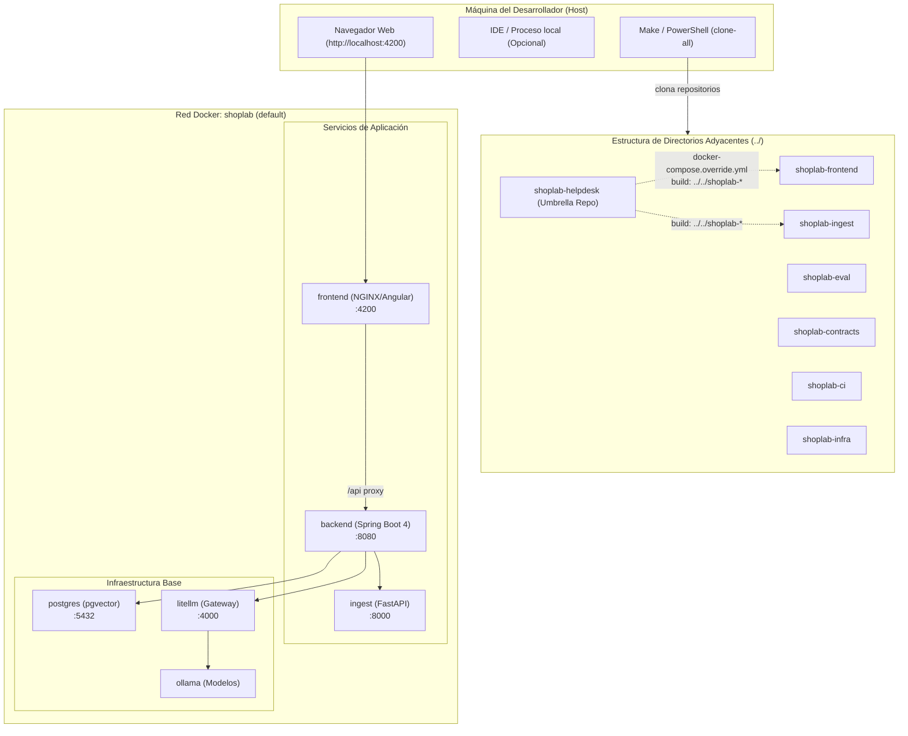

# Data Model & Infrastructure Metadata: LAB-110 Entorno local con varios repos

**Feature**: `LAB-110-multi-repo-local-env`  
**Date**: 2026-11-25  
**Status**: Completed  

---

## 1. Topología del Sistema Local



---

## 2. Matriz de Servicios y Puertos en `infra/docker-compose.yml`

| Servicio | Imagen GHCR (por defecto) | Puerto Host | Puerto Contenedor | Depende de | Healthcheck |
|---|---|---|---|---|---|
| **`postgres`** | `pgvector/pgvector:0.8.7-pg16` | `5432` | `5432` | — | `pg_isready` y verificación extensión `vector` |
| **`ollama`** | `ollama/ollama:0.40.16` | *(interno)* | `11434` | — | `ollama list` verifica modelos descargados |
| **`litellm`** | `ghcr.io/berriai/litellm:1.110.2` | `4000` | `4000` | `litellm-postgres`, `ollama` | `http://localhost:4000/health/liveliness` |
| **`backend`** | `${BACKEND_IMAGE:-ghcr.io/leandroamariles/shoplab-backend:v0.1.0}` | `8080` | `8080` | `postgres`, `litellm`, `ingest` | `http://localhost:8080/actuator/health` |
| **`frontend`** | `${FRONTEND_IMAGE:-ghcr.io/leandroamariles/shoplab-frontend:v0.1.0}` | `4200` | `80` (o `4200`) | `backend` | `wget -q --spider http://localhost:80/` |
| **`ingest`** | `${INGEST_IMAGE:-ghcr.io/leandroamariles/shoplab-ingest:v0.1.0}` | `8000` | `8000` | — | `http://localhost:8000/health` |

---

## 3. Variables de Configuración en `infra/.env`

### Variables de Imágenes de Contenedor

```dotenv
# ==============================================================================
# Imágenes de Servicios de Aplicación (GHCR)
# ==============================================================================
# Tags inmutables fijados por release (prohibido :latest)
BACKEND_IMAGE=ghcr.io/leandroamariles/shoplab-backend:v0.1.0
FRONTEND_IMAGE=ghcr.io/leandroamariles/shoplab-frontend:v0.1.0
INGEST_IMAGE=ghcr.io/leandroamariles/shoplab-ingest:v0.1.0

# Puertos de publicación en el host
BACKEND_PORT=8080
FRONTEND_PORT=4200
INGEST_PORT=8000
```

---

## 4. Estructura del Override de Desarrollo (`infra/docker-compose.override.yml`)

```yaml
# docker-compose.override.yml
# Permite sustituir imágenes de GHCR por compilaciones locales desde carpetas hermanas.
# Copiar este archivo desde infra/docker-compose.override.yml.example.

services:
  # Descomentar para desarrollar sobre el frontend local
  # frontend:
  #   build:
  #     context: ../../shoplab-frontend
  #   image: shoplab-frontend:local

  # Descomentar para desarrollar sobre el microservicio de ingesta local
  # ingest:
  #   build:
  #     context: ../../shoplab-ingest
  #   image: shoplab-ingest:local

  # Descomentar para desarrollar sobre el backend local
  # backend:
  #   build:
  #     context: ../../shoplab-helpdesk/backend
  #   image: shoplab-backend:local
```

---

## 5. Inventario de Repositorios Ecosistema ShopLab

| Nombre del Repositorio | Ruta Relativa desde `shoplab-helpdesk` | Rol Principal | Tecnologías |
|---|---|---|---|
| `shoplab-helpdesk` | `.` | Repositorio paraguas, ADRs, Compose, E2E | Java, Docker Compose, Docs |
| `shoplab-frontend` | `../shoplab-frontend` | Aplicación web de usuario y administración | Angular 19, TypeScript, NGINX |
| `shoplab-ingest` | `../shoplab-ingest` | Microservicio de parseo y chunking | Python 3.12, FastAPI, Uvicorn |
| `shoplab-eval` | `../shoplab-eval` | Suite de evaluación RAGAS y golden dataset | Python 3.12, `uv`, RAGAS |
| `shoplab-contracts` | `../shoplab-contracts` | Paquetes de especificaciones y modelos | OpenAPI 3.1, npm, Python wheel |
| `shoplab-ci` | `../shoplab-ci` | Workflows reutilizables de CI/CD | GitHub Actions (`workflow_call`) |
| `shoplab-infra` | `../shoplab-infra` | Manifiestos Kustomize y GitOps Argo CD | Kubernetes, Kustomize, Argo CD |
