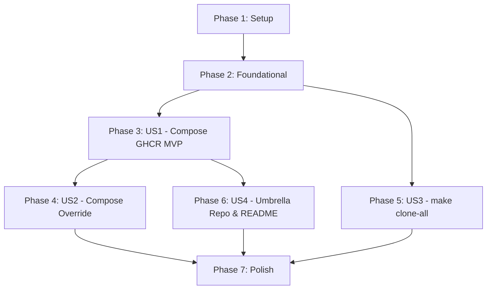

# Tasks: LAB-110 Entorno local con varios repos

**Input**: Design documents from `/specs/LAB-110-multi-repo-local-env/`  
**Prerequisites**: [plan.md](file:///C:/Users/Leandro/IdeaProjects/shoplab-helpdesk/specs/LAB-110-multi-repo-local-env/plan.md), [spec.md](file:///C:/Users/Leandro/IdeaProjects/shoplab-helpdesk/specs/LAB-110-multi-repo-local-env/spec.md), [research.md](file:///C:/Users/Leandro/IdeaProjects/shoplab-helpdesk/specs/LAB-110-multi-repo-local-env/research.md), [data-model.md](file:///C:/Users/Leandro/IdeaProjects/shoplab-helpdesk/specs/LAB-110-multi-repo-local-env/data-model.md), [contracts/](file:///C:/Users/Leandro/IdeaProjects/shoplab-helpdesk/specs/LAB-110-multi-repo-local-env/contracts/), [quickstart.md](file:///C:/Users/Leandro/IdeaProjects/shoplab-helpdesk/specs/LAB-110-multi-repo-local-env/quickstart.md)

---

## Format: `[ID] [P?] [Story] Description`

- **[P]**: Ejecutable en paralelo (archivos independientes, sin colisiones de estado ni dependencias mutuas)
- **[Story]**: Historia de usuario correspondiente (`US1`, `US2`, `US3`, `US4`)
- Rutas explícitas de archivos en `shoplab-helpdesk`

---

## Phase 1: Setup (Prerequisites & Repository Baseline)

**Purpose**: Preparar el árbol de trabajo y las rutas base para las configuraciones y scripts del entorno multi-repo.

- [x] T001 Crear el directorio de scripts `scripts/` en la raíz de `shoplab-helpdesk` si no existe
- [x] T002 [P] Verificar que `.gitignore` incluya las entradas para archivos locales sensibles y overrides (`infra/docker-compose.override.yml`, `infra/.env`)
- [x] T003 [P] Validar el estado y sintaxis inicial de `infra/docker-compose.yml` ejecutando `docker compose -f infra/docker-compose.yml config`

---

## Phase 2: Foundational (Variables de Entorno y Configuración Base)

**Purpose**: Establecer la parametrización de imágenes de GHCR en `.env.example` y `.env` antes de incorporarlas a Compose.

**⚠️ CRITICAL**: Ningún servicio de aplicación en Compose puede configurarse sin tener sus variables parametrizadas con versiones inmutables.

- [x] T004 Actualizar `infra/.env.example` añadiendo la sección de imágenes de aplicación con tags semánticos inmutables: `BACKEND_IMAGE=ghcr.io/leandroamariles/shoplab-backend:v0.1.0`, `FRONTEND_IMAGE=ghcr.io/leandroamariles/shoplab-frontend:v0.1.0`, `INGEST_IMAGE=ghcr.io/leandroamariles/shoplab-ingest:v0.1.0`, y puertos de publicación (`BACKEND_PORT=8080`, `FRONTEND_PORT=4200`, `INGEST_PORT=8000`)
- [x] T005 [P] Sincronizar las nuevas variables en el archivo local `infra/.env` para permitir pruebas inmediatas
- [x] T006 [P] Verificar que ninguna variable de imagen en `infra/.env.example` ni `infra/.env` utilice la etiqueta mutable `:latest`

**Checkpoint**: Base de variables de entorno lista y conforme a las políticas de seguridad.

---

## Phase 3: User Story 1 - Levantamiento completo del sistema con imágenes fijadas de GHCR (Priority: P1) 🎯 MVP

**Goal**: Configurar `infra/docker-compose.yml` para que un desarrollador pueda levantar la totalidad del sistema (infraestructura, backend, frontend e ingest) consumiendo imágenes de GHCR con un único comando.

**Independent Test**: Ejecutar `docker compose -f infra/docker-compose.yml up -d --wait` en una máquina limpia sin otros repositorios clonados, comprobando que `backend`, `frontend`, `ingest`, `postgres` y `litellm` inician en estado `healthy`, respondiendo a sus puertos expuestos en `localhost`.

### Implementation for User Story 1

- [x] T007 [US1] Actualizar la definición del servicio `ingest` en `infra/docker-compose.yml` para utilizar la imagen de GHCR `${INGEST_IMAGE:-ghcr.io/leandroamariles/shoplab-ingest:v0.1.0}` por defecto, eliminando la directiva `build` obligatoria
- [x] T008 [P] [US1] Añadir la definición del servicio `backend` en `infra/docker-compose.yml`:
  - Imagen: `${BACKEND_IMAGE:-ghcr.io/leandroamariles/shoplab-backend:v0.1.0}`
  - Puertos: `"${BACKEND_PORT:-8080}:8080"`
  - Dependencias: `postgres` (condition: service_healthy), `litellm` (condition: service_healthy), `ingest` (condition: service_healthy)
  - Red: `default`
  - Variables de entorno para conexión a Postgres (`POSTGRES_URL=jdbc:postgresql://postgres:5432/shoplab`), LiteLLM (`LITELLM_BASE_URL=http://litellm:4000/v1`) e Ingest (`INGEST_BASE_URL=http://ingest:8000`)
  - Healthcheck: `curl -f http://localhost:8080/actuator/health || exit 1` (o comprobación equivalente)
- [x] T009 [P] [US1] Añadir la definición del servicio `frontend` en `infra/docker-compose.yml`:
  - Imagen: `${FRONTEND_IMAGE:-ghcr.io/leandroamariles/shoplab-frontend:v0.1.0}`
  - Puertos: `"${FRONTEND_PORT:-4200}:80"` (o `4200`)
  - Dependencias: `backend` (condition: service_healthy)
  - Red: `default`
  - Healthcheck: `wget -q --spider http://localhost:80/ || exit 1`
- [x] T010 [US1] Validar sintaxis y resolución de Compose ejecutando `docker compose -f infra/docker-compose.yml config`
- [x] T011 [US1] Ejecutar prueba de validación de arranque de contenedores con `docker compose -f infra/docker-compose.yml up -d` y verificar la conectividad HTTP en `http://localhost:8080/actuator/health` y `http://localhost:4200`

**Checkpoint**: User Story 1 completada (MVP alcanzado). El sistema completo levanta 100 % desde imágenes remotas de GHCR sin compilar código local.

---

## Phase 4: User Story 2 - Desarrollo local sobre un servicio mediante override de compose (Priority: P1)

**Goal**: Proveer y validar el mecanismo `docker-compose.override.yml` que permite a un desarrollador sustituir la imagen de GHCR de un servicio por su construcción local (`build`) apuntando a la carpeta hermana clonada al lado (`../../shoplab-<servicio>`).

**Independent Test**: Copiar `infra/docker-compose.override.yml.example` a `infra/docker-compose.override.yml`, descomentar la directiva de build para `frontend` o `ingest`, verificar con `docker compose config` que la directiva `build` sobreescribe `image`, y comprobar que `docker compose up --build` compila el servicio desde la ruta hermana sin afectar a los demás contenedores.

### Implementation for User Story 2

- [x] T012 [US2] Crear el archivo plantilla `infra/docker-compose.override.yml.example` conforme a [compose-spec-contract.md](file:///C:/Users/Leandro/IdeaProjects/shoplab-helpdesk/specs/LAB-110-multi-repo-local-env/contracts/compose-spec-contract.md), conteniendo bloques comentados y documentados para:
  - `frontend`: `build.context: ../../shoplab-frontend` e `image: shoplab-frontend:local`
  - `ingest`: `build.context: ../../shoplab-ingest` e `image: shoplab-ingest:local`
  - `backend`: `build.context: ../../shoplab-helpdesk/backend` e `image: shoplab-backend:local`
- [x] T013 [P] [US2] Asegurar que `infra/docker-compose.override.yml` está formalmente ignorado en `infra/.gitignore` y en `.gitignore` de la raíz
- [x] T014 [US2] Validar el funcionamiento del override:
  - Copiar temporalmente `infra/docker-compose.override.yml.example` a `infra/docker-compose.override.yml`
  - Ejecutar `docker compose -f infra/docker-compose.yml config` y verificar que el contexto de compilación local se fusiona correctamente
  - Eliminar el archivo temporal para no dejar estado sucio

**Checkpoint**: User Story 2 completada. Cualquier servicio individual puede compilarse desde su repositorio hermano mediante un simple override.

---

## Phase 5: User Story 3 - Clonación orquestada del ecosistema con `make clone-all` (Priority: P2)

**Goal**: Implementar la automatización multiplataforma (`Makefile` y `scripts/clone-all.ps1`) para clonar todos los repositorios hermanos en carpetas adyacentes de forma idempotente y segura.

**Independent Test**: Ejecutar `make clone-all` (en Linux/macOS/Git Bash) o `pwsh scripts/clone-all.ps1` (en Windows PowerShell), comprobando que los 6 repositorios hermanos se clonan en `../shoplab-*`, y que una segunda ejecución sucesiva reporta `[SKIP]` sin fallar ni alterar el código.

### Implementation for User Story 3

- [x] T015 [US3] Crear el archivo `Makefile` en la raíz de `shoplab-helpdesk` conforme a [clone-scripts-contract.md](file:///C:/Users/Leandro/IdeaProjects/shoplab-helpdesk/specs/LAB-110-multi-repo-local-env/contracts/clone-scripts-contract.md):
  - Definir `GIT_BASE_URL ?= https://github.com/leandroAmariles`
  - Definir la lista `REPOS = shoplab-frontend shoplab-ingest shoplab-eval shoplab-contracts shoplab-ci shoplab-infra`
  - Implementar target `clone-all` con verificación `test -d ../$$repo` e impresión informativa `[SKIP]` / `[CLONED]`
  - Implementar target `help` mostrando la ayuda de comandos
- [x] T016 [P] [US3] Crear el script equivalente `scripts/clone-all.ps1` para Windows PowerShell:
  - Soporte de parámetro `-GitBaseUrl` (defecto `https://github.com/leandroAmariles`)
  - Iteración sobre la lista de repositorios y validación con `Test-Path`
  - Salida formateada con colores o prefijos informativos `[SKIP]` y `[CLONED]`
- [x] T017 [US3] Validar la idempotencia y ejecución de ambos scripts:
  - Ejecutar prueba en seco o validación de sintaxis en `scripts/clone-all.ps1` y `Makefile`
  - Comprobar que no se producen errores si los directorios ya existen

**Checkpoint**: User Story 3 completada. El ecosistema completo de repositorios puede clonarse con un único comando en cualquier sistema operativo.

---

## Phase 6: User Story 4 - `shoplab-helpdesk` como repositorio paraguas, documentación y pruebas E2E (Priority: P2)

**Goal**: Consolidar el rol de repositorio paraguas actualizando el `README.md`, documentando el flujo de desarrollo multi-repo y proveyendo un arnés de verificación E2E.

**Independent Test**: Revisar que el `README.md` describe con precisión el flujo de 4 pasos (clonar, levantar todo, override y probar), y ejecutar el script o comando de pruebas E2E validando que todos los servicios integrados responden adecuadamente.

### Implementation for User Story 4

- [x] T018 [US4] Actualizar la sección de inicio y arquitectura de [README.md](file:///C:/Users/Leandro/IdeaProjects/shoplab-helpdesk/README.md):
  - Explicar el rol de `shoplab-helpdesk` como repositorio paraguas (ADRs, guías de fase, Compose central, E2E)
  - Documentar el flujo en 4 pasos: (1) Clonar con `make clone-all`, (2) Levantar con `docker compose up -d`, (3) Desarrollar con override o en host IDE, (4) Probar
  - Documentar la tabla de repositorios del ecosistema con sus enlaces
- [x] T019 [P] [US4] Crear la guía detallada de desarrollo local multi-repo en `docs/fases/F5-entorno-local-multi-repo.md` referenciando los contratos y la guía rápida
- [x] T020 [P] [US4] Implementar el script de pruebas de extremo a extremo e integración `scripts/test-e2e.sh` y `scripts/test-e2e.ps1` (comprobando `/actuator/health`, `/health`, y carga básica de frontend)
- [x] T021 [US4] Añadir el target `test-e2e` en `Makefile` invocando el script de verificación integrada

**Checkpoint**: User Story 4 completada. La gobernanza, documentación y validación E2E del repositorio paraguas quedan formalmente operativas.

---

## Phase 7: Polish & Cross-Cutting Concerns

**Purpose**: Asegurar calidad, coherencia en git y verificación integral de todos los artefactos.

- [x] T022 [P] Ejecutar escaneo de políticas anti `:latest` y validar que todos los manifiestos YAML de Compose y scripts están libres de tags mutables
- [x] T023 [P] Validar que `requests.http` en `specs/LAB-110-multi-repo-local-env/requests.http` cubra las peticiones de salud y smoke test de los servicios orquestados
- [x] T024 Revisar `git status` comprobando que no quedan archivos temporales ni overrides sin ignorar, y verificar que los archivos cumplen con `.editorconfig` (LF, UTF-8)

---

## Dependencies & Execution Order

### Phase Dependencies

### Critical Path & Opportunities for Parallelism

1. **Camino Crítico**: Phase 1 (Setup) → Phase 2 (Foundational) → Phase 3 (US1 - Compose GHCR) → Phase 4 (US2 - Override) → Phase 6 (US4 - Docs/E2E).
2. **Paralelismo**:
   - `T008` (backend en Compose) y `T009` (frontend en Compose) pueden realizarse en paralelo con `T007` (ingest).
   - Phase 5 (`make clone-all` y `clone-all.ps1`) puede ejecutarse en paralelo con Phase 3 y Phase 4 al no depender de los archivos de Compose.
   - `T019` (guía en docs) y `T020` (scripts E2E) pueden desarrollarse en paralelo con `T018` (README).
