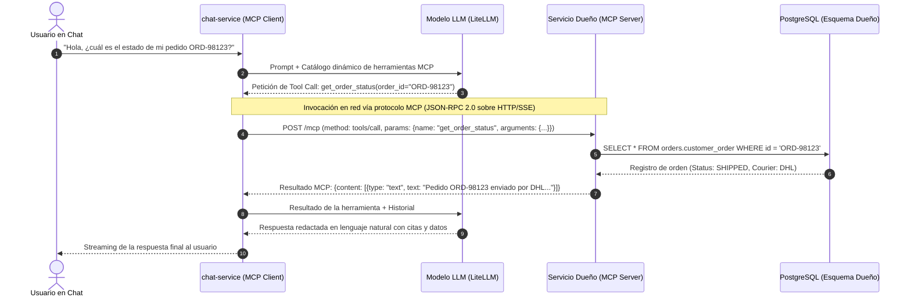

# Contract Specification: Model Context Protocol (MCP) en red para herramientas de agente

**Feature**: `LAB-128-early-extraction-service-map`  
**Date**: 2026-11-23  
**Status**: Draft  

Este contrato especifica la adopción de **Model Context Protocol (MCP)** como estándar de integración entre `chat-service` (cliente MCP) y los servicios de dominio que poseen datos y herramientas (`catalog-service`, `order-service`, `ticket-service`, `retrieval-service`), llevando la regla de encapsulamiento de `@Tool` de ADR-0015 al ámbito de red.

---

## 1. Arquitectura de interacción



---

## 2. Transporte y endpoints de red

- **Transporte estándar**: MCP sobre HTTP con Server-Sent Events (SSE) o Stream bidireccional sobre TLS interno en el clúster.
- **Ruta estándar de exposición en cada servicio**:
  - `GET /mcp/sse`: Establece el canal de eventos del servidor MCP para streaming de respuestas.
  - `POST /mcp/messages`: Envío de mensajes JSON-RPC del cliente MCP al servidor.
- **Autenticación inter-servicio**: Cabecera `Authorization: Bearer <m2m-token>` o mTLS entre pods en Kubernetes, propagando siempre `traceparent` y `X-Request-Id`.

---

## 3. Formato de mensajes JSON-RPC 2.0

### Descubrimiento de herramientas (`tools/list`)

**Petición enviada por `chat-service`**:
```json
{
  "jsonrpc": "2.0",
  "id": "req-001",
  "method": "tools/list",
  "params": {}
}
```

**Respuesta devuelta por `order-service`**:
```json
{
  "jsonrpc": "2.0",
  "id": "req-001",
  "result": {
    "tools": [
      {
        "name": "get_order_status",
        "description": "Consulta el estado actual de un pedido y sus paquetes usando el identificador de orden.",
        "inputSchema": {
          "type": "object",
          "properties": {
            "order_id": {
              "type": "string",
              "description": "Identificador único de la orden (ej. ORD-12345)"
            }
          },
          "required": ["order_id"]
        }
      },
      {
        "name": "track_shipment",
        "description": "Obtiene el historial detallado de rastreo logístico y ubicación de un envío.",
        "inputSchema": {
          "type": "object",
          "properties": {
            "tracking_code": {
              "type": "string",
              "description": "Código de seguimiento proporcionado por el transportista"
            }
          },
          "required": ["tracking_code"]
        }
      }
    ]
  }
}
```

### Ejecución de herramienta (`tools/call`)

**Petición enviada por `chat-service`**:
```json
{
  "jsonrpc": "2.0",
  "id": "call-104",
  "method": "tools/call",
  "params": {
    "name": "get_order_status",
    "arguments": {
      "order_id": "ORD-98123"
    }
  }
}
```

**Respuesta devuelta por `order-service` (Éxito)**:
```json
{
  "jsonrpc": "2.0",
  "id": "call-104",
  "result": {
    "content": [
      {
        "type": "text",
        "text": "{\"order_id\":\"ORD-98123\",\"status\":\"SHIPPED\",\"estimated_delivery\":\"2026-11-26\",\"carrier\":\"DHL Express\",\"tracking_code\":\"TRK-77123\"}"
      }
    ],
    "isError": false
  }
}
```

**Respuesta devuelta por `order-service` (Error controlado / No encontrado)**:
```json
{
  "jsonrpc": "2.0",
  "id": "call-104",
  "result": {
    "content": [
      {
        "type": "text",
        "text": "No se encontró ningún pedido con el identificador ORD-98123 en el sistema."
      }
    ],
    "isError": true
  }
}
```

---

## 4. Políticas de resiliencia y degradación

1. **Timeout acotado**: La llamada MCP desde `chat-service` tendrá un timeout estricto de **3 segundos**. Si el servicio dueño no responde, se cancela la llamada reactiva.
2. **Degradación elegante**: Cuando una herramienta MCP falla o excede el timeout:
   - `chat-service` **no aborta el turno** ni interrumpe el streaming SSE.
   - Pasa al LLM un resultado indicando que el servicio dueño correspondiente no se encuentra disponible temporalmente.
   - El modelo responde con empatía al usuario solicitando reintentar más tarde o canalizar la duda por otro medio.
3. **Métricas y observabilidad**:
   - `shoplab.mcp.client.calls`: Contador por servicio (`service=catalog|orders|tickets|retrieval`), herramienta (`tool=...`) y estado (`status=success|error|timeout`).
   - Trazas distribuidas propagadas vía cabecera `traceparent`.
