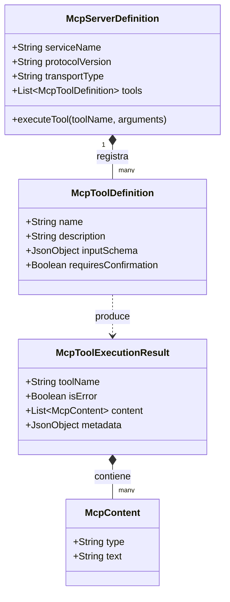
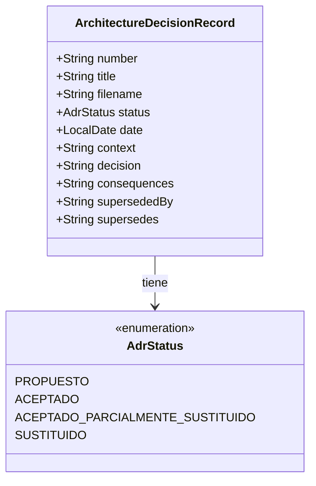
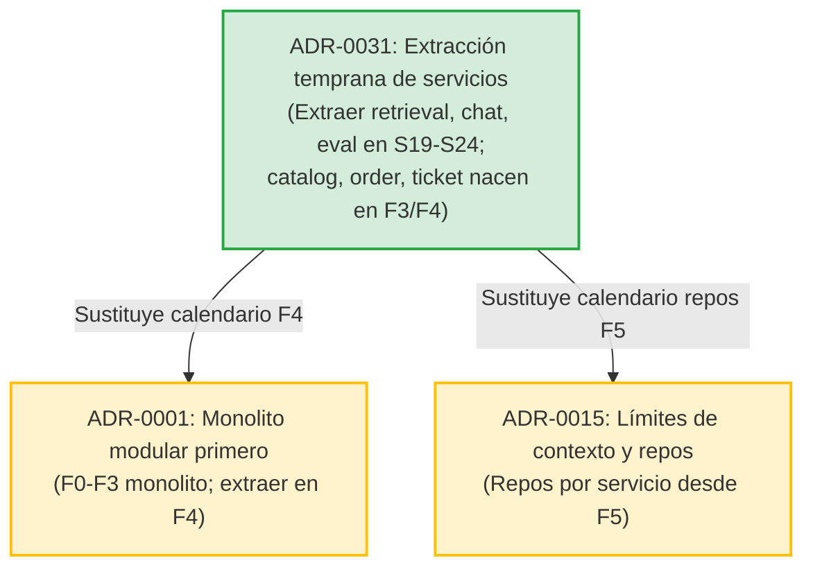

# Data Model & Architecture Boundaries: Extracción temprana y mapa de servicios

**Feature**: `LAB-128-early-extraction-service-map`  
**Date**: 2026-11-23  
**Status**: Draft  

Este documento define las entidades conceptuales, la soberanía de esquemas de datos de los 8 servicios de destino y las estructuras formales para la gobernanza de herramientas MCP y decisiones de arquitectura (ADR).

---

## 1. Soberanía de esquemas de datos por servicio

En cumplimiento de ADR-0015, ADR-0031 y el Principio de Soberanía de Datos, cada microservicio es el propietario exclusivo de su esquema de base de datos. Está estrictamente prohibido compartir tablas, establecer claves foráneas (`FOREIGN KEY`) entre esquemas o ejecutar sentencias `JOIN` que involucren más de un contexto delimitado.

```mermaid
erDiagram
    CHAT_SERVICE ||--o{ CHAT_SCHEMA : "posee exclusivamente"
    RETRIEVAL_SERVICE ||--o{ RETRIEVAL_SCHEMA : "posee exclusivamente"
    EVAL_SERVICE ||--o{ EVAL_SCHEMA : "posee exclusivamente"
    CATALOG_SERVICE ||--o{ CATALOG_SCHEMA : "posee exclusivamente"
    ORDER_SERVICE ||--o{ ORDER_SCHEMA : "posee exclusivamente"
    TICKET_SERVICE ||--o{ TICKET_SCHEMA : "posee exclusivamente"
    NOTIFICATION_SERVICE ||--o{ NOTIFICATION_SCHEMA : "posee exclusivamente"
    GATEWAY ||--o{ STATELESS : "sin persistencia"

    CHAT_SCHEMA {
        conversation conversation_session
        conversation_turn conversation_turn
        feedback chat_feedback
    }

    RETRIEVAL_SCHEMA {
        document source_document
        chunk vector_chunk_hnsw
    }

    EVAL_SCHEMA {
        eval_run test_run_metadata
        eval_case evaluation_case_result
    }

    CATALOG_SCHEMA {
        product product_item
        category product_category
        inventory stock_balance
    }

    ORDER_SCHEMA {
        customer_order order_record
        order_item order_line_item
        shipment shipping_tracking
    }

    TICKET_SCHEMA {
        support_ticket ticket_header
        ticket_message ticket_thread_message
    }

    NOTIFICATION_SCHEMA {
        notification_log delivery_audit_log
    }
```

### Tabla de esquemas y titularidad

| Esquema PostgreSQL | Servicio Titular | Repositorio Destino | Tablas Principales | Restricciones de Acceso |
|---|---|---|---|---|
| `chat` | `chat-service` | `shoplab-chat-service` | `conversation`, `conversation_turn`, `feedback` | Exclusivo para `chat-service`. Ningún otro servicio lee ni escribe en `chat`. |
| `retrieval` | `retrieval-service` | `shoplab-retrieval-service` | `document`, `chunk` (con extensiones `pgvector`) | Exclusivo para `retrieval-service`. La ingesta de datos entrega salidas a través de su API. |
| `eval` | `eval-service` | `shoplab-eval-service` | `eval_run`, `eval_case` | Exclusivo para `eval-service`. `shoplab-eval` (Python) y `admin-eval` consumen vía REST. |
| `catalog` | `catalog-service` | `shoplab-catalog-service` | `product`, `category`, `inventory` | Exclusivo para `catalog-service`. Nace directamente como microservicio en F3. |
| `orders` | `order-service` | `shoplab-order-service` | `customer_order`, `order_item`, `shipment` | Exclusivo para `order-service`. Nace directamente como microservicio en F4. |
| `tickets` | `ticket-service` | `shoplab-ticket-service` | `support_ticket`, `ticket_message` | Exclusivo para `ticket-service`. Nace directamente como microservicio en F4. |
| `notification` | `notification-service` | `shoplab-notification-service` | `notification_log` | Exclusivo para `notification-service`. Consume eventos asíncronos de Kafka. |
| *(ninguno)* | `gateway` | `shoplab-gateway` | *(stateless)* | No posee persistencia; actúa como proxy inverso perimetral. |

---

## 2. Modelo conceptual de herramientas MCP (Model Context Protocol)

Cada servicio que expone capacidades operativas para el agente conversacional implementa la especificación de **Model Context Protocol (MCP)**. Las herramientas se definen mediante metadatos declarativos y esquemas JSON Schema.

### Catálogo de herramientas MCP por servicio dueño

| Servicio Dueño (Servidor MCP) | Nombre de Herramienta MCP | Descripción para el LLM | Parámetros de Entrada (JSON Schema) | Salida Estructurada |
|---|---|---|---|---|
| **`catalog-service`** | `search_products` | Busca productos en el catálogo por texto libre, categoría o rango de precios. | `query` (string, req), `category` (string, opt), `max_price` (number, opt) | Lista de productos coincidentes (id, título, precio, stock disponible). |
| **`catalog-service`** | `get_product_details` | Obtiene la ficha técnica, descripción y disponibilidad de un producto por su id. | `product_id` (string, req) | Detalle completo del producto, especificaciones y estado de inventario. |
| **`order-service`** | `get_order_status` | Consulta el estado actual de un pedido y sus paquetes asociados usando el código de pedido. | `order_id` (string, req), `customer_id` (string, opt) | Estado del pedido (`PENDING`, `SHIPPED`, `DELIVERED`), fecha estimada de entrega y transportista. |
| **`order-service`** | `track_shipment` | Proporciona el historial de eventos de rastreo y localización de un envío. | `tracking_code` (string, req) | Lista cronológica de hitos de entrega y ubicación actual del paquete. |
| **`ticket-service`** | `create_ticket` | Crea una incidencia o solicitud de soporte para el equipo humano cuando el bot no puede resolver la duda. | `customer_id` (string, req), `subject` (string, req), `description` (string, req), `priority` (string, opt) | `ticket_id`, estado inicial (`OPEN`), y fecha estimada de primera respuesta. |
| **`ticket-service`** | `get_ticket_status` | Consulta el progreso, mensajes y estado de un ticket de soporte existente. | `ticket_id` (string, req) | Estado del ticket, agente asignado, última actualización y mensajes públicos. |
| **`retrieval-service`** | `search_knowledge_base` | Realiza una búsqueda semántica e híbrida sobre la base de conocimiento y políticas de la tienda. | `query` (string, req), `top_k` (integer, opt) | Fragmentos relevantes recuperados con citas y metadatos del documento fuente. |

---

## 3. Modelo documental de gobernanza arquitectónica (ADR)

Para preservar la inmutabilidad y coherencia de las decisiones de arquitectura, se modela la estructura de metadatos de los ADRs bajo `docs/adr/`.

### Relación entre ADR-0001, ADR-0015 y ADR-0031

