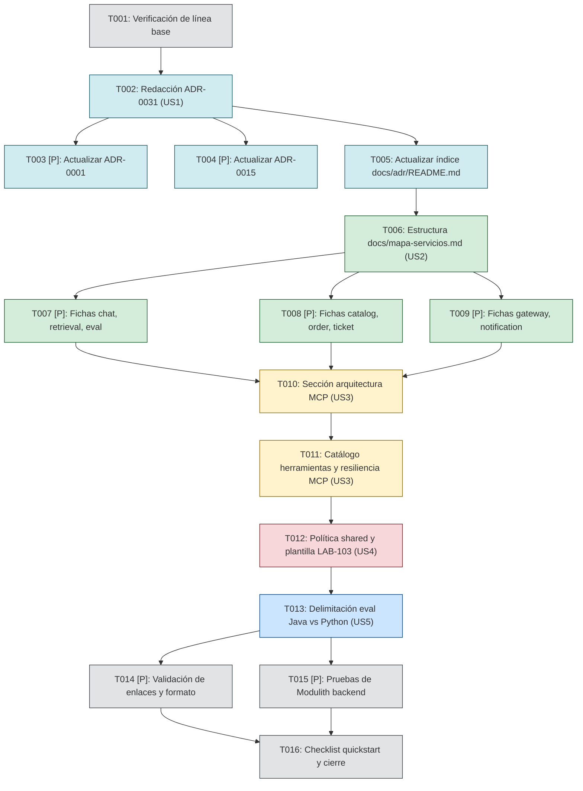

# Tasks: ADR de extracción temprana y mapa de servicios

**Input**: Documentos de diseño en `specs/LAB-128-early-extraction-service-map/`  
**Prerequisitos**: [plan.md](plan.md), [spec.md](spec.md), [research.md](research.md), [data-model.md](data-model.md), [contracts/service-map-schema.md](contracts/service-map-schema.md), [contracts/mcp-tool-protocol.md](contracts/mcp-tool-protocol.md), [quickstart.md](quickstart.md)

**Organización**: Las tareas están agrupadas por fase y por historia de usuario (US1–US5) conforme a las prioridades definidas en `spec.md`, permitiendo validar y entregar cada componente de arquitectura y gobernanza de manera incremental.

## Formato: `[ID] [P?] [Historia] Descripción con ruta`

- **[P]**: Se puede ejecutar en paralelo (archivos distintos, sin dependencias pendientes)
- **[US#]**: Historia de usuario de `spec.md` a la que pertenece
- Rutas relativas a la raíz del repositorio:
  - `DOCS` = `docs/`
  - `ADR` = `docs/adr/`
  - `SPEC` = `specs/LAB-128-early-extraction-service-map/`
- Convenciones: Redacción en español, formato Markdown estándar con enlaces relativos válidos, sin saltos de línea huérfanos y respetando las reglas de inmutabilidad y numeración de ADRs.

---

## Phase 1: Setup (Línea base y verificación de entorno)

**Propósito**: Confirmar el estado limpio del repositorio y la línea base de pruebas antes de generar los documentos de arquitectura.

- [x] T001 Verificar la línea base del proyecto en la rama `feature/LAB-128-early-extraction-service-map`: comprobar que `git status` está limpio y que los tests de arquitectura de Modulith pasan en verde ejecutando `cd backend && ./mvnw test -Dtest='ModularityTests,ModuleArchitectureTests'`.

---

## Phase 2: User Story 1 — Registro de ADR-0031 y actualización de decisiones previas (Priority: P1) 🎯 MVP Gobernanza

**Goal**: Registrar la decisión formal de extracción temprana de servicios tras F2 (S19–S24) en `ADR-0031` y actualizar los estados y referencias de `ADR-0001`, `ADR-0015` y del índice general `docs/adr/README.md`.

**Independent Test**: Verificar la existencia de `docs/adr/0031-extraccion-temprana-de-servicios.md`, comprobar que `0001-monolito-modular-primero.md` y `0015-limites-de-contexto-y-repositorios.md` están marcados como parcialmente sustituidos por ADR-0031, y confirmar que `docs/adr/README.md` refleja los tres cambios con enlaces válidos.

- [x] T002 [US1] Redactar y crear `ADR/0031-extraccion-temprana-de-servicios.md` a partir de `0000-plantilla.md`:
  - Título: `# ADR-0031: Extracción temprana de servicios`
  - Estado: `aceptado` | Fecha: `2026-11-23`
  - Sección Contexto: Desbalance de líneas de código (`chat` ~5.600, `retrieval` ~2.400, `eval` ~1.400 vs `orders`, `catalog` y `tickets` vacíos); nota de trazabilidad indicando que atiende la decisión planteada en Jira LAB-128 (F5-21).
  - Sección Decisión: Extracción de `retrieval`, `chat` y `eval` en S19–S24; nacimiento de `catalog`, `order` y `ticket` directamente como microservicios en F3/F4; adopción de MCP para herramientas; destino del módulo `shared` vía plantilla LAB-103; y separación de `eval-service` (Java) y `shoplab-eval` (Python).
  - Sección Consecuencias: Sustitución parcial de ADR-0001 (calendario de F4) y ADR-0015 (repositorios desde F5), reducción de costes de refactorización y habilitación de LAB-108 y LAB-103.
- [x] T003 [P] [US1] Actualizar `ADR/0001-monolito-modular-primero.md`: cambiar la línea de estado a `- Estado: aceptado (parcialmente sustituido por ADR-0031)` e incorporar al final de la sección Consecuencias una nota explicando que la extracción de servicios se adelanta a la finalización de F2 (S19–S24) conforme a `ADR-0031`.
- [x] T004 [P] [US1] Actualizar `ADR/0015-limites-de-contexto-y-repositorios.md`: cambiar la línea de estado a `- Estado: aceptado (parcialmente sustituido por ADR-0031)` e incorporar al final de la sección Consecuencias una nota explicando que la política de repositorios independientes se anticipa a S19 en lugar de esperar a F5 conforme a `ADR-0031`.
- [x] T005 [US1] Actualizar la tabla índice de decisiones en `ADR/README.md`: añadir la fila `0031 | [Extracción temprana de servicios](0031-extraccion-temprana-de-servicios.md) | aceptado` y actualizar las filas de `0001` y `0015` para reflejar el estado `aceptado (parcialmente sustituido por 0031)`.

**Checkpoint**: US1 completa y trazable; los ADRs reflejan sin contradicciones el nuevo calendario de extracción.

---

## Phase 3: User Story 2 — Mapa completo de servicios de destino (Priority: P1) 🎯 MVP Arquitectura

**Goal**: Crear `docs/mapa-servicios.md` documentando la topología de los 8 servicios (`chat-service`, `retrieval-service`, `eval-service`, `catalog-service`, `order-service`, `ticket-service`, `gateway`, `notification-service`) con soberanía de esquemas, APIs, eventos y dependencias.

**Independent Test**: Leer `docs/mapa-servicios.md` y comprobar que contiene las fichas completas de los 8 servicios, sin huecos en la definición de esquemas de datos, APIs de entrada, eventos producidos/consumidos ni dependencias.

- [x] T006 [US2] Crear la estructura inicial de `DOCS/mapa-servicios.md`:
  - Título general, contexto de descomposición tras F2 y justificación arquitectónica.
  - Principio inviolable de soberanía de esquemas de datos: 1 esquema PostgreSQL por servicio, sin joins ni claves foráneas inter-servicio.
  - Tabla matriz comparativa de los 8 servicios (Servicio, Repositorio, Esquema DB, Tipo de Servicio, Fase de Entrada).
- [x] T007 [P] [US2] Redactar las fichas técnicas de los servicios maduros a extraer en `DOCS/mapa-servicios.md` (conforme a `contracts/service-map-schema.md`):
  - `chat-service`: Repositorio `shoplab-chat-service`, esquema `chat`, streaming SSE (`POST /api/chat`), feedback, eventos `chat.turn.completed`, dependencias (LiteLLM, PostgreSQL, clientes MCP).
  - `retrieval-service`: Repositorio `shoplab-retrieval-service`, esquema `retrieval` (pgvector), REST (`/api/retrieval/**`), eventos `retrieval.document.indexed`, dependencias (Ollama/LiteLLM embeddings, PostgreSQL).
  - `eval-service`: Repositorio `shoplab-eval-service`, esquema `eval`, REST (`/api/eval/**`), eventos `eval.run.completed`, dependencias (PostgreSQL, frontend admin-eval).
- [x] T008 [P] [US2] Redactar las fichas técnicas de los servicios de negocio que nacerán en F3/F4 en `DOCS/mapa-servicios.md`:
  - `catalog-service`: Repositorio `shoplab-catalog-service`, esquema `catalog`, REST (`/api/catalog/**`), eventos `catalog.product.updated`, dependencias (PostgreSQL). Nace en F3.
  - `order-service`: Repositorio `shoplab-order-service`, esquema `orders`, REST (`/api/orders/**`), eventos `orders.order.created/shipped`, dependencias (PostgreSQL). Nace en F4.
  - `ticket-service`: Repositorio `shoplab-ticket-service`, esquema `tickets`, REST (`/api/tickets/**`), eventos `tickets.ticket.created/escalated`, dependencias (PostgreSQL). Nace en F4.
- [x] T009 [P] [US2] Redactar las fichas técnicas de los servicios de plataforma y soporte en `DOCS/mapa-servicios.md`:
  - `gateway`: Repositorio `shoplab-gateway` / componente de plataforma en `shoplab-infra`, sin persistencia (stateless), enrutamiento perimetral, propagación de contexto (`traceparent`, `X-Request-Id`).
  - `notification-service`: Repositorio `shoplab-notification-service`, esquema `notification` (auditoría), consumidor Kafka de eventos de pedidos y tickets, proveedor de email/SMS.
  - Diagrama de relaciones de dependencias de red y asíncronas para confirmar la ausencia de ciclos circulares.

**Checkpoint**: US2 completa; el mapa de servicios describe sin ambigüedad la arquitectura de destino de los 8 servicios.

---

## Phase 4: User Story 3 — Adopción de Model Context Protocol (MCP) para herramientas de agente (Priority: P1)

**Goal**: Documentar formalmente en `docs/mapa-servicios.md` y en `ADR-0031` la arquitectura de herramientas de agente sobre MCP en red, garantizando que los servicios dueños actúan como servidores MCP y `chat-service` como cliente MCP remoto.

**Independent Test**: Verificar en `docs/mapa-servicios.md` la sección dedicada a MCP que describe el transporte (HTTP/SSE), el catálogo de herramientas por servicio dueño, los contratos JSON-RPC 2.0 y las políticas de resiliencia (timeout ≤ 3 s y degradación elegante).

- [x] T010 [US3] Incorporar en `DOCS/mapa-servicios.md` la sección detallada sobre arquitectura Model Context Protocol (MCP):
  - Justificación del traslado de la regla de `@Tool` en `api` de ADR-0015 al ámbito distribuido de red.
  - Especificación del rol de servidor MCP para `catalog-service`, `order-service`, `ticket-service` y `retrieval-service`.
  - Especificación del rol de cliente MCP para `chat-service` sobre transporte HTTP/SSE.
- [x] T011 [US3] Documentar en `DOCS/mapa-servicios.md` el catálogo de herramientas MCP y las políticas de resiliencia (conforme a `contracts/mcp-tool-protocol.md`):
  - Herramientas: `search_products`, `get_product_details`, `get_order_status`, `track_shipment`, `create_ticket`, `get_ticket_status`, `search_knowledge_base`.
  - Esquemas de parámetros en JSON Schema.
  - Política de resiliencia: Timeout estricto de 3 segundos, captura de fallos de red sin romper el streaming SSE, y respuesta degradada en lenguaje natural para el cliente.

**Checkpoint**: US3 completa; el modelo de integración de herramientas queda blindado contra dependencias binarias o acoplamiento de dominio.

---

## Phase 5: User Story 4 — Política sobre el módulo shared y plantilla de servicio (Priority: P1)

**Goal**: Formalizar en la documentación y en `ADR-0031` la prohibición de librerías comunes con lógica de dominio y establecer la adopción de la plantilla de servicio de LAB-103 para la infraestructura técnica base.

**Independent Test**: Comprobar que en `docs/mapa-servicios.md` y en `ADR/0031-extraccion-temprana-de-servicios.md` se prohíbe expresamente cualquier artefacto Maven compartido con lógica o entidades de dominio y se detalla el uso de la plantilla de `LAB-103`.

- [x] T012 [US4] Documentar en `DOCS/mapa-servicios.md` y en `ADR/0031-extraccion-temprana-de-servicios.md` la estrategia sobre el módulo `shared` (ADR-0010):
  - Prohibición explícita de librerías Maven comunes que contengan entidades, repositorios o casos de uso de dominio.
  - Mandato de uso del arquetipo/plantilla de microservicio gobernado en `LAB-103` para replicar utilidades técnicas base (jerarquía de excepciones, filtro de correlación, respuesta estándar `ResponseDto`, logging seguro).
  - Regla de autonomía para catálogos de códigos de error: cada microservicio administra su propio prefijo (`CHAT_...`, `CAT_...`, `ORD_...`).

**Checkpoint**: US4 completa; la política previene de raíz el antipatrón de «monolito distribuido».

---

## Phase 6: User Story 5 — Separación de eval-service (Java) y shoplab-eval (Python) (Priority: P2)

**Goal**: Clarificar y delimitar las fronteras entre `shoplab-eval-service` (Java) y `shoplab-eval` (Python), documentando sus repositorios, esquemas, APIs e interacción en los pipelines de CI.

**Independent Test**: Verificar en `docs/mapa-servicios.md` la sección de evaluación, comprobando la delimitación precisa entre el servicio Java de persistencia y la herramienta Python de ejecución de métricas RAGAS.

- [x] T013 [US5] Documentar en `DOCS/mapa-servicios.md` y en `ADR/0031-extraccion-temprana-de-servicios.md` la separación funcional y de repositorios para evaluación:
  - `shoplab-eval-service` (Java): Titular del esquema `eval`, APIs REST para `admin-eval` y almacenamiento inmutable de corridas históricas.
  - `shoplab-eval` (Python, proyecto `uv`): Repositorio dedicado al dataset golden (`golden.jsonl`), scripts de validación de reglas y ejecución de métricas RAGAS/DeepEval en CI.
  - Flujo de interacción en CI: El runner Python ejecuta la evaluación contra el backend y reporta los resultados vía REST a `eval-service` para su persistencia.

**Checkpoint**: US5 completa; responsabilidades delimitadas sin duplicidad ni ambigüedades.

---

## Phase 7: Polish & Cross-Cutting Concerns (Verificación y Cierre)

**Propósito**: Asegurar la calidad documental, la validez de los enlaces y la ausencia de regresiones en la suite de pruebas del proyecto.

- [x] T014 [P] Validar la consistencia de enlaces relativos y formato Markdown: comprobar que todas las referencias entre `docs/`, `docs/adr/`, `specs/LAB-128-early-extraction-service-map/` y `README.md` son válidas y navegan correctamente.
- [x] T015 [P] Ejecutar la suite de pruebas del backend y de Modulith para certificar que el código del monolito modular no sufre alteraciones ni regresiones:
  `cd backend && ./mvnw test -Dtest='ModularityTests,ModuleArchitectureTests'`.
- [x] T016 Ejecutar la validación final conforme a [quickstart.md](quickstart.md) y documentar la finalización de los criterios de aceptación de Jira LAB-128.

---

## Dependencias y Orden de Ejecución

